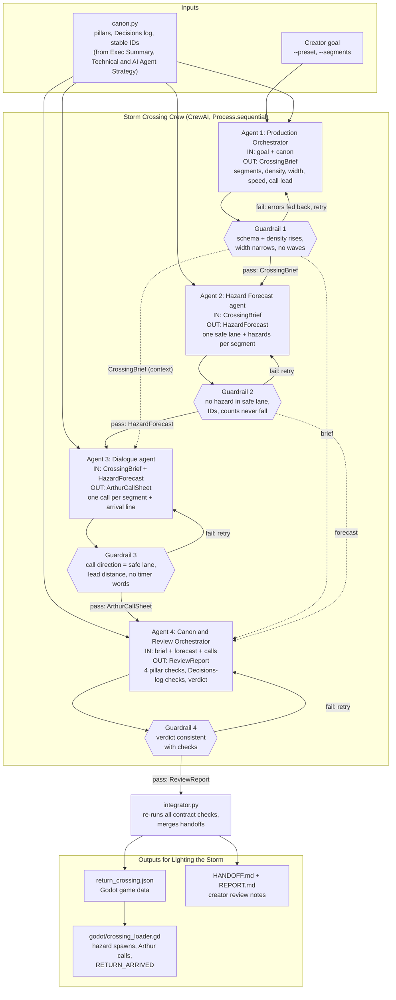
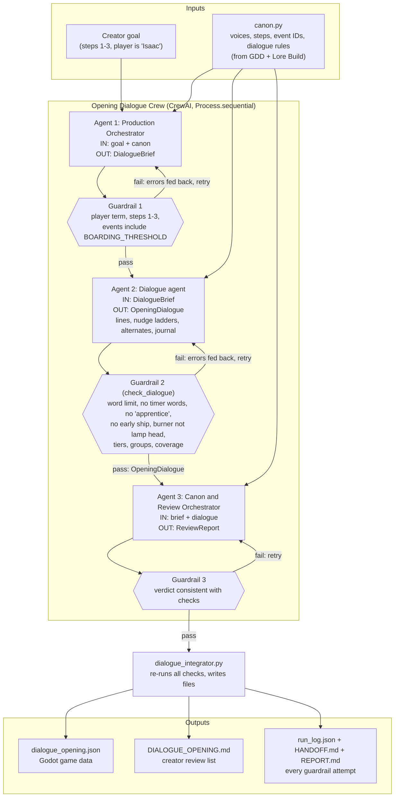

# Storm Crossing Crew — for *Lighting the Storm*

**Game:** *Lighting the Storm* — a first-person, single-player atmospheric folk-horror adventure for PC, built in Godot 4 with GDScript.

**What this crew produces:** the game data for the **return crossing** of the Gate 1 vertical slice — the timed boat run from the abandoned outpost back to the Bracken Isle lighthouse with the replacement beacon burner aboard. One run of the crew outputs `return_crossing.json`, which the game loads directly, plus the `HANDOFF.md` and `REPORT.md` notes the creator uses to review the work before merging it.

## Why the game needs this

In *Lighting the Storm*, the apprentice steers a powered boat with one control at one fixed speed while Arthur, an old seaman, shouts directions over the storm. The return crossing is where the hidden ship deadline is running, so it is the part of the game where the design rules matter most. The design documents set several hard rules for it:

- Hazard density, route width and visibility must rise with route position, never with elapsed time (the "storm split").
- There is one shared hazard forecast with a single safe-route signal per segment, and Arthur's calls must never disagree with it.
- Only rocks, reefs, buoys and debris are allowed. Waves are an unapproved stretch goal, and route branching is deferred.
- There is no visible timer. Every collision is recoverable to a safe point.

Getting the hazard layout, the safe route and Arthur's lines to agree by hand is fiddly and easy to break whenever one piece is tuned. This crew generates all three together from one brief, checks them against each other and against the design pillars, and hands the creator a package that is consistent by construction. Regenerating it for a different difficulty preset (`standard` or `assist`) or route length is one command.

## The agents

The design submission (*Lighting the Storm - Design Submission*, updated 1 October 2026) defines **ten worker roles, each owning one department, overseen by two orchestrators**. The full roster is in `roles.py`. These are roles, not twelve agents running at once, and only the developer merges their work.

| Role | Kind | Owns | Review gate |
|---|---|---|---|
| **Production Orchestrator** * | Orchestrator | Task briefs, dependency order, event IDs and contracts, integrated build | Escalates on a missed exit test, contract change, task conflict or week 5 slip |
| **Canon and Review Orchestrator** * | Orchestrator | Pillar, scope-rule and decisions-log checks; the decisions log | Escalates on a canon question or a failed pillar test |
| **Boat / Physics agent** | Worker | Boat scene, controller, tuning resource | Developer plays the week-2 steering spike (go/no-go) |
| **Level Layout agent** | Worker | Greybox scenes, anchors | Traversal and sightline checks in the engine |
| **Gameplay / Systems agent** | Worker | Phase controller, save state, repairs, deadline | 10-minute slice plays end to end |
| **Hazard Forecast agent** * | Worker | Shared forecast, safe-route signal | Arthur's calls never disagree with the world |
| **Story / Fail-State agent** | Worker | Fail presentation, ship reveal, Ted's lamp staging | A tester can say why they failed from every expiry location |
| **Lighting agent** | Worker | Light rigs, visibility presets | Beacon and hazards legible at every phase |
| **Sound agent** | Worker | Audio banks, mix states | Arthur's warnings audible at peak storm |
| **Asset agent** | Worker | Source meshes, import settings | Assets import cleanly, fit the reference sheet |
| **Dialogue agent** * | Worker | Dialogue and journal data | Developer approves voice and lore before recording |
| **QA agent** | Worker | Scenario list, bug reports | Developer reproduces and prioritises each finding |

\* = runs in the return-crossing crew below. The other eight are in the roster but are not needed to generate this data.

### The return-crossing crew (four of the twelve)

They run in sequence, and each one's output is validated before the next can start.

| # | Agent | Input | Output | Why the pipeline breaks without it |
|---|---|---|---|---|
| 1 | **Production Orchestrator** | Creator goal, preset, segment count, canon | `CrossingBrief`: segment IDs, length, hazard density, route width, minimum visibility, boat speed, Arthur's call lead distance, constraints | Nobody defines the segments, tuning or difficulty curve. Agent 2 has nothing to place hazards into. |
| 2 | **Hazard Forecast agent** | `CrossingBrief` | `HazardForecast`: one safe lane per segment, hazards (type, lane, distance, readability cue), recovery safe points | There is no safe-route signal, so Arthur has nothing to call and the game has nothing to spawn. |
| 3 | **Dialogue agent** | `CrossingBrief` + `HazardForecast` | `ArthurCallSheet`: one shouted call per segment that matches its safe lane, subtitles, the arrival line ("go, go, go — don't wait for me") | The player gets no guidance. Pillar 3 says guidance comes from Arthur, not from markers. |
| 4 | **Canon and Review Orchestrator** | All three handoffs | `ReviewReport`: four pillar checks, Decisions-log checks, PASS/REVISE verdict, open creator decisions, handoff summary | The integrator refuses to write game data without a review, and `HANDOFF.md` has no verdict or evidence. |

**How the agents coordinate.** Every task has a CrewAI guardrail (`validators.py`). When an agent's output breaks the contract, for example when Arthur says "right" where the forecast's safe lane is "left", the specific error is sent back to that agent and it retries, up to three times. Validated outputs are stored in a shared state and passed on as context to later agents. After the crew finishes, `integrator.py` runs every check again end to end before it writes any game data.

## Architecture

The same diagram is in `crew_architecture.mermaid`.



## Running it

```bash
pip install -r requirements.txt

# 1. Smoke test, no API key needed: the full CrewAI pipeline runs with a scripted LLM
python main.py --offline

# 2. Real run: copy .env.example to .env and add your ANTHROPIC_API_KEY
python main.py
python main.py --preset assist --segments 4 --out output_assist
```

| Flag | Default | Meaning |
|---|---|---|
| `--offline` | off | Use `offline_llm.py` (deterministic, no key) instead of a real model |
| `--preset` | `standard` | `standard` or `assist` (the reduced hazard-intensity preset) |
| `--segments` | `5` | Route segments, 3–8 |
| `--goal` | Gate 1 return-crossing goal | The creator's goal text given to the Production Orchestrator |
| `--out` | `output` | Output folder |
| `--quiet` | off | Hide CrewAI's verbose agent logs |

You can switch models with `CREW_MODEL` in `.env`. Any CrewAI/LiteLLM model string works, for example `openai/gpt-4o-mini` with `OPENAI_API_KEY` set.

**Offline mode** exists so the crew can be run and marked without an API key. It still runs the real CrewAI agents, tasks, context passing and guardrails. Only the model's text is scripted. On purpose, the Dialogue agent gets one call wrong on its first attempt. The console then shows `Guardrail blocked (attempt 1/4) ... ARTHUR_RET_02 says 'right' but the forecast safe lane for SEG_02 is 'left'`, followed by the corrected retry, so you can see the agents coordinating. The creative content in a real run comes from the LLM.

## Output

```
output/
├── return_crossing.json      # loaded by the game
├── HANDOFF.md                # 8 fixed headings from the AI Agent Strategy
├── REPORT.md                 # orchestrator report, fixed headings
└── handoffs/                 # each agent's validated output, for traceability
    ├── 01_brief.json
    ├── 02_forecast.json
    ├── 03_calls.json
    └── 04_review.json
```

`return_crossing.json` holds the tuning values (fixed boat speed, call lead, route length, `waves_enabled: false`) and the stable event IDs (`RETURN_DEPARTED`, `SEGMENT_ENTERED`, `HAZARD_COLLISION`, `RECOVERY`, `RETURN_ARRIVED`). For each segment it gives the safe lane, the recovery point, the hazards with their absolute route positions, and Arthur's call with its trigger position. `sample_output/` contains a complete offline run.

**Using it in Godot 4:** copy the JSON to `res://data/` and attach `godot/crossing_loader.gd` to the sea scene. Each physics frame, call `advance(route_m)`. The loader emits `arthur_call`, `segment_entered` and `return_arrived` signals and provides `hazards()` for the spawner. `reset_for_restart()` supports the Gate 1 "fail, then restart the slice" model.

## The Opening Dialogue Crew (second pipeline)

A second crew writes the Gate 1 **opening dialogue** (steps 1-3: coal in the basement boiler, let the stranded sailors in, retrieve the burner) for Ted, Arthur and Daniel. It uses the same roster, the same schema + validator + guardrail pattern and the same offline mode as the crossing crew. Three of the twelve roles run:

| # | Agent | Input | Output | Guardrail (validators.py) |
|---|---|---|---|---|
| 1 | **Production Orchestrator** | Creator goal + canon | `DialogueBrief`: steps, every event ID, word limit, player term, constraints | `check_dialogue_brief`: player term is the creator's, steps 1-3, `BOARDING_THRESHOLD` exists |
| 2 | **Dialogue agent** | `DialogueBrief` | `OpeningDialogue`: lines, alternates, nudge ladders, assist hints, journal | `check_dialogue`: word limit, no timer words or numbers, no 'apprentice', no early ship, 'burner' not 'lamp head', no supernatural confirmation, 'SPEAKER:' subtitles, tiers, groups, coverage |
| 3 | **Canon and Review Orchestrator** | Brief + dialogue | `ReviewReport` (reused) | `check_review` (reused) |



```bash
python main_dialogue.py --offline                      # no API key: scripted model, real agents and guardrails
python main_dialogue.py                                # a real model writes the lines
python main_dialogue.py --offline --max-words 12       # negative test: the checks block it and no game data is written
python main_dialogue.py --offline --godot-dir ../../../LightingTheStorm   # also copies the JSON into the game project
```

Offline mode replays `offline_dialogue_draft.json` (the 61 lines first drafted for the creator). As with the crossing crew, its first attempt deliberately contains faults (an 'apprentice', an early mention of the ship, a 'lamp head') so the console shows `Guardrail blocked (attempt 1/4)` and the corrected retry. Use `--no-demo-errors` to skip that. Every attempt is recorded in `run_log.json`. `sample_output_dialogue/` holds a complete run plus the negative test.

**Live runs.** Set `ANTHROPIC_API_KEY` in `.env`. If Anthropic answers 400 about a workspace, also set `ANTHROPIC_WORKSPACE_ID` (the key is not workspace-scoped). If it answers 404 for the model, set `CREW_MODEL` to one your workspace has (for example `anthropic/claude-sonnet-5-5`). A REVIEW verdict of REVISE still writes files, but marks the JSON `needs_revision` and lists the reviewer's issues; read them before using the lines. `sample_output_live/` holds the first live run.

**Revision loop.** If the reviewer returns REVISE, the crew does not stop: its failed checks and issues go back to the Dialogue agent (`dialogue_revision.py`), the corrected dialogue goes through the same `check_dialogue` guardrail, and the Canon and Review Orchestrator re-reviews it (up to `--max-revisions`, default 2). Superseded rounds are kept in `handoffs/history_round*`. Two checks were added after the first live run: a line's `step` must equal its trigger event's step, and a reviewer's "all N lines" claims must match the data. `python main_dialogue.py --revise-from sample_output_live --out sample_output_live_revised` continues a saved run; `--simulate-revise` (offline) tests the loop for free. `sample_output_live_revised/` holds the live run after one revision (verdict PASS, 14 of 14 checks).

## The Asset agent and the World Crew (third and fourth pipelines)

Two more pipelines, built for the Godot environment and the FAL asset work. Same pattern as the others: schema + deterministic checks + CrewAI guardrails + an offline mode.

| Pipeline | Agents | Run | Output |
|---|---|---|---|
| **Asset review** | **Asset agent** | `python main_asset.py sample_submissions --offline` | `asset_reviews/<id>.review.json`, `<id>.approved_prompt.txt`, `summary.json` |
| **World crew** | **Boat / Physics agent**, **Player Movement agent** (new role), **Lighting agent**, then the Canon and Review Orchestrator | `python main_world.py --offline` | `world_output/boat_spec.json`, `player_movement_spec.json`, `lighting_spec.json`, `HANDOFF.md`, `REPORT.md` |

**Asset agent.** Run it on every FAL submission before you spend a generation. A submission is a `*.fal.json` file (`asset_id`, `category`, `fal_model`, `prompt`, `negative_prompt`, optional `source_image`, `notes`; see `sample_submissions/`). The checks read `Docs/Lore Build/world/style_guide.md` live (`style_guide.py`), so editing the guide changes what is approved:

- the prompt uses the guide's style descriptors (cel shading plus at least three of four groups);
- no reference touchstones, "in the style of", artist names, photoreal, modern or sci-fi wording, or the retired name Brusskania;
- nothing from the guide's global negative list appears in the positive prompt, and the negative prompt contains all of them;
- any `#hex` colour is in the guide palette; Saint Calder prompts carry amber, gold and "gothic";
- if `source_image` is given, Pillow checks it is muted, dark and near the palette (all 31 concept images pass).

The agent writes a verdict, a repaired prompt and negative prompt, the Godot folder for the category (`res://Assets/Models/<category>/`) and import notes (scale, pivot, collision, materials). The guardrail refuses an APPROVE when the checks found problems and refuses a revised prompt that still breaks the guide. `python main_asset.py <files> --check-only` runs just the deterministic checks without any model.

**Boat / Physics agent.** One fixed speed, steered only by **A and D** (`move_left`, `move_right`); W and S do nothing. The spec covers the OUTBOUND leg `DOCK_LIGHTHOUSE -> DOCK_PORT` (the Saltgate quays) and the RETURN leg back, waypoints, steering response and a rudder that returns to centre, automatic docking zones, collision recovery and handling checks. `waves_enabled` is false and a `tide_hook` marks where a tide force plugs in later.

**Player Movement agent.** Walking and turning tuning (unsmoothed mouse look, delta-time movement, simultaneous move and turn, slope and step limits from the real island collider) plus seven glitch checks (slopes, lips, turning while moving, corners, falling through, frame rate, camera), each with a repeatable test. `tools/debug_walk.gd` in the Godot project is one such test.

**Lighting agent.** Four phases (ISLAND, OUTBOUND, RETURN, BEACON_RELIT), the eclipsed or absent moon, lightning (flash-rate capped at 3 per second, reveals hazards, driven by phase and route position, never elapsed time), the lighthouse beacon, arc lamp, steam glow and windows, the boat lamp, and distant Saint Calder (amber and gold only). Every colour must be in the style guide palette and no light may be a navigation marker.

Offline mode makes the first Boat attempt press a throttle key and the first Lighting attempt use a neon colour, so you can see the guardrails block and the agents retry. Pass `--no-demo-errors` to skip that. On Windows, set `PYTHONIOENCODING=utf-8` to silence harmless console encoding noise from CrewAI's live display.

### Reminder: build the Tide / Wave agent next

The **Tide / Wave agent is deliberately not built yet.** Build it once there is a traversable Godot level (the lighthouse island with the player walking and the boat crossing). The waves in the crossing are a game mechanic, but the rules still say otherwise, so do these first:

1. Update `canon.py`, `validators.py` (`check_brief`) and `schemas.py` (`HazardType`) so waves are approved and say how a tide affects the crossing (the lore says the eclipse makes tides more aggressive).
2. Add the agent to `roles.py` and run it in the crossing crew next to the Hazard Forecast agent, so Arthur's calls and the safe lane read the tide schedule.
3. Connect it to the boat's `tide_hook` and set `waves_enabled` to true only then.
4. Replace the cosmetic wave shader in `LightingTheStorm/scripts/world/sea.gd` with one driven by the same tide data.

## Files

| File | Purpose |
|---|---|
| `main.py` | CLI entry point: picks the LLM, runs the crew, writes outputs |
| `roles.py` | The full 12-role roster from the design submission |
| `crew.py` | The four crossing agents, their tasks, context links and guardrails |
| `schemas.py` | Pydantic contracts for every handoff |
| `validators.py` | Deterministic cross-checks (the game's rules as code) |
| `canon.py` | Canon taken from the three design documents |
| `integrator.py` | Final checks; writes game data, HANDOFF.md and REPORT.md |
| `offline_llm.py` | Scripted LLM for runs without a key |
| `godot/crossing_loader.gd` | Reads the output in the game |
| `crew_architecture.mermaid` | Architecture diagram |
| `dialogue_crew.py` | The three dialogue agents, their tasks, context links and guardrails |
| `dialogue_integrator.py` | Final checks; writes `dialogue_opening.json`, the review list, HANDOFF.md, REPORT.md, run_log.json |
| `main_dialogue.py` | CLI for the dialogue crew |
| `offline_dialogue_llm.py`, `offline_dialogue_draft.json` | Scripted model and the draft it replays |
| `dialogue_crew_architecture.mermaid` | Dialogue crew diagram |
| `style_guide.py` | Reads `style_guide.md` and runs the prompt and image style checks |
| `world_schemas.py`, `world_validators.py`, `world_canon.py` | Contracts, checks and canon for the Asset, Boat, Player Movement and Lighting agents |
| `asset_crew.py`, `main_asset.py` | The Asset agent and its CLI |
| `world_crew.py`, `main_world.py` | The Boat, Player Movement and Lighting agents plus reviewer, and their CLI |
| `offline_world_llm.py`, `llm_factory.py` | Scripted model for both new crews; real model setup |
| `sample_submissions/` | Example FAL submissions (one good, one deliberately bad) |

## Scope and limits

The crew follows the game's own rules for agents: it only proposes, and the creator reviews and merges. It does not decide the open canon questions (exact collision time cost, deadline length, pause exploits, the final retry and save model). Those are carried into `HANDOFF.md`. Steering feel, hazard readability in engine and Arthur's voice performance still need human playtesting.
