# Lighting the Storm: Final Assessment

**Student / creator:** KeaneTheory · **Engine:** Godot 4.3 (GDScript) · **Repository:** `keanetheory/AI_GameDev`, branch `dialogueandmusic`, commit `cf92e6c` (3 Nov 2026) · **Build:** Windows 64-bit download

This document holds the three deliverables. Every claim points to a file in the repository, so a grader can check it.
Costs are actual: FAL is reconciled to the provider's export, the rest are the creator's account figures; nothing is
estimated where a real number exists.

| # | Deliverable | Where |
|---|---|---|
| 1 | Playable link | [Section 1](#1-playable-link) |
| 2 | Pipeline to Game Connection, with the Automated Flow Description | [Section 2](#2-pipeline-to-game-connection) |
| 3 | Pipeline audit and cost analysis (3a to 3i) | [Section 3](#3-pipeline-audit-and-cost-analysis) |

**How this maps to the marking criteria**

| Criterion | Evidence in this document |
|---|---|
| Pipeline-to-Game Connection (3.0) | 2.1 the flow; 2.4 the traceability table: each piece of content traced from the agent output file to the file the game loads, with the test that proves it plays |
| Engine Integration (2.0) | 2.3 the Automated Flow Description, and 2.5 the measured proof that the agent output lands unreformatted (180 of 182, 234 of 235, 69 of 72 values byte-identical, the rest creator tuning) |
| Cost Analysis (2.0) | 3e to 3g: the FAL spend reconciled to the cent against the provider's export, the most expensive step, sustainability |
| Pipeline Audit (1.0) | Section 3 (one page): output, manual steps, one architectural change, a before/after cost reduction |

---

## 1. Playable link

**itch.io:** https://keanetheory.itch.io/lighting-the-storm (Windows download, `LightingTheStorm_windows.zip`, 379 MB)

1. Download the zip, right-click it, choose **Extract All**.
2. Open the `LightingTheStorm` folder and run **`LightingTheStorm.exe`** (the `.exe` and the `.pck` must stay together).
3. Windows SmartScreen may warn about an unrecognised app (the exe is not code-signed): **More info, then Run anyway**.

**Controls:** WASD move, mouse look, Shift sprint, Space jump, E interact, J journal, P pause, Esc free the mouse, C hide the
controls. **Length:** about 10 to 15 minutes. **Difficulty** (title screen, Left/Right): Easy 3:00, Medium 2:30, Hard 2:00
for the hidden return deadline.

**System requirements** (measured on the exported build, `requirements.md`): Windows 10/11 64-bit, a Vulkan GPU, 8 GB RAM.
A dedicated GPU (GTX 1060 / 1650 or better) is recommended: on an RTX 4070 Laptop it holds 230 to 240 fps; on Intel
integrated graphics it runs 16 to 36 fps (the lamp room about 19), which the QA agent filed as backlog T79.

---

## 2. Pipeline to Game Connection

### 2.1 The pipeline, from the GDD to the exe

```mermaid
flowchart LR
  GDD["GDD + Lore Build<br/>Docs/GDD, Docs/Lore Build"] --> CANON["canon.py<br/>story beats, event IDs,<br/>banned words, rules"]
  CANON --> CREWS
  subgraph CREWS["AI Agent Crew (CrewAI, AIAgentCrew/)"]
    DC["Opening Dialogue Crew"] ; VC["Voice Casting Crew"] ; SC["Storm Crossing Crew"] ; WC["World Crew"] ; AC["Asset Crew + FAL sender"]
  end
  CREWS -->|"Pydantic schema +<br/>guardrail, retry x3"| REVIEW["Canon and Review<br/>Orchestrator verdict"]
  REVIEW --> HUMAN["Creator gate<br/>(picks, approvals)"]
  HUMAN -->|"integrator --godot-dir<br/>main_fal --go"| DATA["Godot project<br/>data/*.json, Assets/"]
  DATA --> LOAD["GDScript loaders<br/>read at runtime"]
  LOAD --> SCENE["Level.tscn<br/>(plays)"]
  SCENE --> TESTS["63 headless tests +<br/>full playthrough"]
  TESTS --> EXE["Windows export<br/>+ icon + zip"]
  GER["GER Framework<br/>creator/assessor agents"] -.->|plans, reviews| DATA
  GOA["Goal-Oriented Agent<br/>backlog (86 tasks)"] -.->|priorities| GER
```

| Stage | What it is | Files |
|---|---|---|
| **1. Design** | The GDD (Exec Summary, Technical Strategy, AI Agent Strategy) and the Lore Build (51 documents) | `Docs/GDD/Final_GDD_Post_Review/`, `Docs/Lore Build/` |
| **2. Canon** | The GDD's rules turned into code every crew must obey: the seven story beats, the event IDs, banned words ("lad", "lamp head", "outpost"), no timer words | `AIAgentCrew/canon.py`, `story_beats.py`, `style_guide.py` |
| **3. Generation** | Five CrewAI crews from the 12-role roster (`roles.py`), each with a typed output contract | `AIAgentCrew/main_*.py`, `*_crew.py`, `schemas.py` |
| **4. Validation** | Every task has a guardrail (`validators.py`): a contract break goes back to that agent with the exact error, up to three retries; the Canon and Review Orchestrator writes a PASS/REVISE verdict | `validators.py`, `voice_validators.py`, `world_validators.py`, `*/handoffs/` |
| **5. Human gate** | The creator picks lines, approves voices, and approves every plan before it runs (the GER gate) | `apply_creator_picks.py`, `GERFramework/ger.py approve` |
| **6. Integration** | The integrators write the validated JSON straight into the Godot project; the FAL sender writes the model straight into `Assets/Models/<category>/` | `dialogue_integrator.py`, `integrator.py`, `main_world.py --godot-dir`, `main_fal.py`, `main_elevenlabs.py` |
| **7. Engine** | GDScript loaders read the files at runtime; an import script scales and pivots every generated model | `scripts/dialogue/dialogue_loader.gd`, `scripts/world/crossing_loader.gd`, `scripts/world/lighting_rig.gd`, `tools/import_scale_pivot.gd` |
| **8. Verification** | 63 headless test scripts run against the real level, including a scripted full playthrough that asserts every story moment's line is spoken | `LightingTheStorm/tools/test_*.gd`, `tools/run_all_tests.sh` |
| **9. Build** | The Windows export preset, the icon script, the zip | `requirements.md` ("Building the download"), `tools/set_exe_icon.py` |
| **Management** | The Goal-Oriented Agent keeps the scored backlog; the GER Framework runs creator agents (Island, Lighthouse Interior, Saltgate, Cliffside, Wave, Playtest QA, itch.io Deployment) each held by an assessor agent, offline by default | `GoalOrientedAgent/`, `GERFramework/` |

The engine code itself (83 GDScript files, 17,145 lines, 63 test scripts) was written by Claude Code (Claude Opus) working
as the coding agent under the creator's direction: 141 of the repository's 200 commits carry its co-author line.

### 2.2 The crews and what each one hands to the engine

| Crew (`AIAgentCrew/`) | Agents | Output contract | Lands in the game as | Read by |
|---|---|---|---|---|
| Opening Dialogue Crew (`main_dialogue.py`) | Production Orchestrator, Dialogue agent, Canon and Review | `OpeningDialogue` (lines, triggers, delivery, journal) | `data/dialogue/dialogue_opening.json` | `dialogue_loader.gd` |
| Voice Casting Crew (`main_voice.py`) then the ElevenLabs sender (`main_elevenlabs.py`) | Sound agent, Canon and Review | `VoiceCastingPlan` (voice profiles, per-line tags and settings) | one `<line_id>.mp3` per line, in `Assets/Audio/voice/` | `dialogue_loader.gd` (by line ID) |
| Storm Crossing Crew (`main.py`) | Production Orchestrator, Hazard Forecast agent, Dialogue agent, Canon and Review | `CrossingBrief` -> `HazardForecast` -> `ArthurCallSheet` -> `ReviewReport` | `data/world/return_crossing.json` (5 segments, 15 hazards, Arthur's calls; copied in, see 3b) | `crossing_loader.gd`, `crossing_sequence.gd` |
| World Crew (`main_world.py`) | Boat / Physics, Player Movement, Lighting agents | boat, player-movement and lighting specs | `data/world/boat_spec.json`, `player_movement_spec.json`, `lighting_spec.json` | `boat.gd`, `player.gd`, `lighting_rig.gd` |
| Asset Crew (`main_asset.py`) then the FAL sender (`main_fal.py`) | Asset agent, Canon and Review | `FalSubmission` (prompt, category, model, target size), checked offline with `--check-only` | `Assets/Models/<category>/<id>.glb` + `<id>.fal_result.json` (request ID, prompt, model) | `import_scale_pivot.gd`, then the scene |

### 2.3 Automated Flow Description

**The contract is the format.** Each crew's output is a Pydantic model in `schemas.py` (`OpeningDialogue`,
`HazardForecast`, `VoiceCastingPlan`, `FalSubmission`, ...). The GDScript loader that reads the file expects exactly those
fields. Because the agent can only finish its task by producing a value that validates against the model, nothing the
agent writes needs reformatting before Godot reads it: if the JSON is wrong, the guardrail rejects it and the agent retries
(up to three times) before anything reaches the project.

**The event IDs are shared.** `canon.py` (`OPENING_EVENTS`, `LATER_EVENTS`) and `scripts/core/game_state.gd` (`EVENTS`) hold
the same list of stable IDs (`GAME_STARTED`, `FIREBOX_APPROACHED`, `BURNER_DIAGNOSED`, `SHIP_FAIL`, ...). A dialogue line's
`trigger` is one of those IDs, so when the scene fires `GameState.emit_event("BOILER_FED")`, the loader plays every line the
crew wrote for that moment. Nothing maps one to the other by hand.

**The files land in the engine without a copy step:**
- `main_dialogue.py --godot-dir ../LightingTheStorm` and `apply_creator_picks.py --install` write
  `data/dialogue/dialogue_opening.json`; `main_world.py --godot-dir` writes the three world specs into `data/world/`.
- `main_fal.py --go` downloads the generated model straight to `Assets/Models/<category>/<id>.glb`. Its `.glb.import`
  names `tools/import_scale_pivot.gd`, an `EditorScenePostImport` script that scales the model to its category's real-world
  size (1 unit = 1 m) and moves the pivot to the base, so a model drops onto the floor at the right size.
- `main_elevenlabs.py tts --send` writes one mp3 per line ID. `dialogue_loader.gd` looks for
  `res://Assets/Audio/voice/<line_id>.mp3`: if the clip is there it plays it on the Voice bus and waits for its length; if
  not, the line still plays as a subtitle on a reading timer. Adding a clip needs no code change.

**At runtime it simply works in the scene.** `dialogue_loader.gd` (an autoload) parses the JSON on start, indexes lines by
trigger, applies the `requires` conditions (e.g. Daniel only speaks with the player in the basement), plays the clip, shows
the subtitle and drives the jaw lip-sync. The crossing loader spawns the 15 hazards from `return_crossing.json` and the
crossing sequence plays Arthur's call for each segment. The lighting rig reads `lighting_spec.json` and the boat reads
`boat_spec.json` on `_ready`.

**It is proven, not asserted.** `tools/test_slice_playthrough.gd` loads the real `Level.tscn`, plays the whole slice from
the knock to the win, and fails if any story event fires out of order or any moment's line is not spoken ("every moment had
its line spoken"). On 3 Nov 2026 the suite gave 63 pass, 1 skip by design, 0 fail
(`GERFramework/reports/playtest_qa_suite.md`).

### 2.4 Traceability: content in the build, back to the agent that made it

| In the game | Agent output | In the engine | Proof it plays |
|---|---|---|---|
| Ted's greeting "Hrmph. The new guy. Storm season..." (`TED_S1_01`) | Opening Dialogue Crew, `AIAgentCrew/sample_output_live/dialogue_opening.json` (live run, 15 Oct), creator picks in `sample_output_picked/` | `data/dialogue/dialogue_opening.json`, trigger `GAME_STARTED` | `test_intro_sequence.gd`, `test_slice_playthrough.gd` |
| Ted's voice for that line | Voice Casting Crew, `AIAgentCrew/voice_output_current_live/voice_casting.json` (live, 3 Nov) -> ElevenLabs | `Assets/Audio/voice/TED_S1_01.mp3` | `dialogue_loader.gd` plays it; checked 3 Nov (line held 14.15 s = clip 13.92 s + 0.25 s) |
| The return crossing: 5 segments, 15 hazards, the safe lane, Arthur's calls `ARTHUR_RET_01..05` | Storm Crossing Crew, `AIAgentCrew/output/return_crossing.json` | `data/world/return_crossing.json` | `test_crossing_sequence.gd` (40 PASS) |
| The barograph on the keeper's wall | Asset agent submission, then `main_fal.py` (FAL `hunyuan3d-v3/text-to-3d`, request `01a19dbf-6157-7560-a570-9f7fee6809c7`) | `Assets/Models/prop/lhi_barograph.glb` + `.fal_result.json` (the prompt and request ID) | `test_hero_props.gd` |
| The boat's handling, the player's movement, the lighting phases | World Crew, `AIAgentCrew/world_output/*.json` | `data/world/boat_spec.json`, `player_movement_spec.json`, `lighting_spec.json` | `test_boat.gd`, `test_island_lighting.gd` |
| Bracken Isle, the Saltgate, the cliffs, the lighthouse exterior, the passenger ship, the props | 78 FAL generations with their `.fal_result.json` records | `Assets/Models/**` (101 models in use) | `test_island_coverage.gd`, `test_cliff_clean.gd`, `ger.py audit` (mesh auditor) |

**Output evidence:** each row above can be checked from the repository: the agent output file, the file the game loads, and the headless test that plays it (`godot --headless --path LightingTheStorm --script res://tools/<test>.gd`, or `LightingTheStorm/tools/run_all_tests.sh` for the whole suite).

### 2.5 Measured: the agent output lands unreformatted

Comparing each crew's own output file with the file the game reads today (every value, flattened):

| File | Values written by the crew | Unchanged | What changed, and why |
|---|---:|---:|---|
| `player_movement_spec.json` | (all) | **100%** (byte-identical) | nothing |
| `return_crossing.json` | 182 | **180** | Arthur's line "Hard left, **lad**!" -> "Hard left!" (the canon bans "lad"; the line and its subtitle) |
| `lighting_spec.json` | 235 | **234** | the dynamic-light budget 16 -> 18 (a creator tuning decision), plus a note |
| `boat_spec.json` | 72 | **69** | speed 3 -> 8 m/s and waves on (creator tuning), the tide hook's description, two notes |

No field was renamed, restructured or reformatted. The six changed values are design tuning decided after playtesting, not
format fixes; they are discussed as a manual step in 3b.

---

## 3. Pipeline audit and cost analysis

### Pipeline Production & Functionality

**3a. What did the pipeline produce?** (present in the playable build)
- **Dialogue:** 68 spoken lines (Ted 34, Arthur 31, Daniel 3) across 54 story events, plus 3 journal entries, all with
  subtitles, triggers and delivery notes (`data/dialogue/dialogue_opening.json`).
- **Voice:** 68 recorded clips in three designed voices (Ted re-designed with an English accent on 3 Nov), placed in the
  world by distance and floor (`Assets/Audio/voice/`).
- **The return crossing:** 5 segments, 15 hazards with a safe lane, and Arthur's 5 calls (`return_crossing.json`).
- **World specs:** the boat, player movement and lighting rig (`data/world/`), and the other runtime specs there, each
  marked with the agent role that owns it (audio mix: Sound agent; goals and controls: Gameplay / UI agent; outcome
  screens: Story / Fail-State agent; the sequences: Gameplay / Systems agent; waves: Wave Creator agent).
- **3D content:** 78 FAL / Hunyuan3D generations in the build (the island, harbour, Saltgate quay and hut, cliffs, the
  passenger ship and launch, buoys and 57 lighthouse props) and three characters (Ted, Arthur, Daniel; meshes from FAL,
  rigged in Meshy).
- **The level:** Bracken Isle and the lighthouse interior (five floors built room by room by the Lighthouse Interior
  creator agent and Lighthouse Finisher), the Saltgate, the cliffside walkway.
- **Not from the pipeline (made by the creator):** the music (three tracks, KeaneTheory) and the lighthouse pages and
  posters (ChatGPT images). The placeholder sound effects are synthesised by `tools/make_placeholder_audio.py`.

**3b. What manual steps remain?**
1. **Voice clips and the crossing data** are written to the crew's folders; copying them into `Assets/Audio/voice/` and
   `data/world/return_crossing.json` is a separate step (the Storm Crossing integrator, `main.py`, has no `--godot-dir`).
2. **Prop placement:** a generated model lands in `Assets/Models/prop/`, but its place in a room is a row in the `ENTRIES`
   table in `hero_props.gd`, and `tools/import_new_props.py` (texture downscale, import file) and Blender decimation
   (`tools/decimate_glb.py`) are run by hand.
3. **Character rigging** happens in the Meshy web app (FAL's rig has 24 bones, the animations need the 65-bone rig).
4. **Tuning edits** (boat speed, light budget, one line) were made straight in the game's JSON, not fed back to the crew.
5. **The Windows build** is three commands (export, icon, zip); the music conversion (`.m4a` to `.ogg`) was done by hand.
6. **Deliberate human gates** (not friction): the creator's line picks, voice approval and the GER plan approval.

**3c. What would it take to eliminate them?**
1. Give `main_elevenlabs.py` and the Storm Crossing `main.py` the same `--godot-dir` the dialogue and world integrators
   have, writing into `Assets/Audio/voice/` and `data/world/`.
2. Have the Level Layout agent output a placements file (`data/world/props.json`) that `hero_props.gd` reads instead of a
   code table, and have `main_fal.py` run `import_new_props.py` and the decimation step after each download.
3. Rig through an API (Meshy's rigging API with the 65-bone skeleton) or a scripted Blender auto-rig, called by the sender.
4. Store tuning as an overrides file the integrator applies on every run, so the crew's output stays the source and the
   tuning is replayed, not hand-edited.
5. `tools/build_windows.py` (export, icon, smoke test, zip) and a `butler` push, already planned as DEP-01 and DEP-05 of the
   itch.io Deployment agent. The human gates stay: they are the review the brief asks for.

### Architectural Reflection *(draft for the creator to amend)*

**3d. Current architectural decision to change:** I let the game's data files become the place where content was edited.
The crews wrote `dialogue_opening.json` once (15 Oct); after that the humour pass, the story-beat rewrites and every fix
were made directly in the game's copy. The crews' own copy (`sample_output_picked/`) fell behind, so the pages built from it
went out of date, the voice crew had to be re-pointed at the game's file, and its schema rejected the newer content (it
still capped the script at step 3 when the game had five steps). One speaker mistake (`ARTHUR_S0_13`, a line of Ted's
labelled as Arthur's) had spread to 30 files.

**Specific alternative:** one source of truth with a one-way flow. The crew output stays the only authored copy; every
human change is either a creator pick or an entry in an overrides file (`data/overrides/*.json`: a line ID or a field path,
the new value, who decided and when). The integrator applies picks and overrides and writes the game's files on every run,
the game's files are marked "generated, do not edit", and a test fails if a game file differs from crew output plus
overrides. Docs, voice casting and audits all read the generated file, so they can never drift from what the game plays.

### Cost Analysis

**3e. Total actual run cost: $120.40 for the content-generation run; $160.40 for the whole project including the coding
agent** (Claude Code, $40, paid by ELVTR). One month of each content subscription is counted: the generation runs fall
between 12 Oct and 3 Nov 2026.

| Service | What it produced | Actual usage | Cost | Source |
|---|---|---|---:|---|
| **FAL** (Hunyuan3D v3 text- and image-to-3D, v2 multi-view, Meshy rigging, two image models) | every generated 3D model | 14 billed days, 12 Oct to 2 Nov | **$38.40** (of $40.00 paid in) | `Game Audit/FAL_SPEND.md`, reconciled to the cent against FAL's usage export |
| **Anthropic API** (the crews' live runs, Claude Sonnet) | 2 live Opening Dialogue runs (15 Oct), 3 live Voice Casting runs (15 Oct, 3 Nov x2) | the crews did not log tokens | **$30.00** (at most, from the Anthropic console) | the runs: `AIAgentCrew/*/run_log.json` |
| **ChatGPT** (subscription) | the lighthouse pages and posters | 1 month | **$25.00** | creator's account |
| **Meshy** (subscription) | character rigging (Ted, Arthur, Daniel), lampposts | 1 month | **$15.00** | creator's account |
| **ElevenLabs** (subscription; Voice Design v3, TTS `eleven_v3`) | 3 voices + 1 re-design, 68 lines + re-records | **13,262 characters** of TTS (15 Oct 2,825; 3 Nov 6,565 + 3,802 + 70) + 1,220 characters of voice-design text | **$12.00** | creator's account; characters counted from `AIAgentCrew/voice_output_*/elevenlabs/tts_requests.json` |
| **Total, content generation** | | | **$120.40** | |
| Claude Code (Claude Team standard seat; the coding agent that wrote the engine code) | 141 of 200 commits | $20 a month, 18 Sep to 15 Nov 2026 (used to expiry: 2 billing months) | **$40.00**, paid by ELVTR (the course) | the seat's account details |
| **Total, whole project** | | | **$160.40** ($120.40 paid by the creator) | |

Every other crew run was offline (a scripted model, zero tokens), and the GER assessments run offline by rule.

**3f. Most expensive pipeline step:** **3D prop generation with `fal-ai/hunyuan3d-v3/text-to-3d`: $22.875, 60% of the FAL
spend** (61 models at 25 units, $0.375 each). The single most expensive run was the 1 Nov prop batch: 29 generations,
$10.875 (T45 props, the buoys, Daniel's chair, the Saltgate hut). Next: `hunyuan3d-v3/image-to-3d` $14.325 (the island,
harbour, city, ship, characters; billed by units per job, from 35 to 485 units a day). By service, FAL ($38.40) is the
largest, ahead of the Anthropic API ($30 at most, spread over five live crew runs, about $6 a run) and the flat
subscriptions.

**3g. Solo / small-team sustainability:** **Yes, sustainable.** The whole slice's content cost $120.40: $38.40 of per-use
3D generation (about $0.49 per model in the build), $30 of API calls, and $52 of monthly subscriptions. With the coding
agent ($40 for the seat over the project) the whole project is $160.40, about a third of the planning estimate of about
$500 in Claude tokens for the prototype alone
(`Docs/GDD/Final_GDD_Post_Review/Supporting_Documentation/Token Costs and Feasibility.md`): a flat-fee seat replaced the
per-token API budget the plan assumed. Most of it is flat monthly fees,
so a solo developer can predict it, and the per-use part (FAL, the API) is small and capped by prepaid credit. Two risks
for a small team: **re-work multiplies spend** (the voices were recorded on 15 Oct, then 35 of the 39 lines changed, so the
characters sent grew from 2,825 to 13,262, over four times; it fitted inside the $12 plan this time, but a larger script
would not) and **unrecorded spend** (52% of the FAL dollars had no record in the repo until the 2 Nov audit). With a script
freeze before recording and a ledger on every paid call, the same pipeline would make another slice for roughly the same
$120 a month, which one person can sustain.

### Mid-Project Cost-Reduction Change

**3h. Strategy / prompting approach**
- **Before (1 Nov, T45):** generate every prop on the list. The Lighthouse Finisher sent all 27 prop prompts through FAL
  text-to-3d in one batch and re-rolled two that came back wrong.
- **After (2 Nov, T69):** inventory first, then rank and reuse. The agent listed every greybox left in the lighthouse,
  prepared 15 prompts and checked them offline (`main_asset.py --check-only`, zero cost), ranked them by how visible each is
  on the player's route, and first applied free fixes: reused the existing oilskin coat model for the oilskins and the
  pendant lamp for the store bulb, and hid the linen and the tub tap. Only ranks 1 to 12 were generated
  (`LightingTheStorm/FAL_GREYBOX_PROPS.md`, `GERFramework/reports/lighthouse_finisher_fal_ledger.json`).

**3i. API cost**
- **Before:** 29 FAL calls, **$10.875** for 27 props: $0.403 per prop installed, 7% of the spend on re-rolls.
- **After:** 12 FAL calls, **$4.50** for 16 greyboxes resolved (12 generated, 2 reused, 2 hidden): **$0.281 per greybox
  resolved, 30% cheaper per item**, with no re-rolls and $1.125 not spent on the three lowest-ranked props.

---

*Sources: the repository at commit `cf92e6c`. Cost figures: `Game Audit/FAL_SPEND.md` (FAL dashboard export, 3 Oct to
2 Nov 2026, plus the 2 Nov ledger entry), `AIAgentCrew/voice_output_*/elevenlabs/tts_requests.json` (ElevenLabs
characters); the Anthropic API figure, the ChatGPT, Meshy and ElevenLabs subscription fees and the Claude Team seat
($20 a month from 18 Sep to 15 Nov 2026, paid by ELVTR) are from the creator's accounts (3 Nov 2026). Test results: `GERFramework/reports/playtest_qa_suite.md` (3 Nov 2026).*
