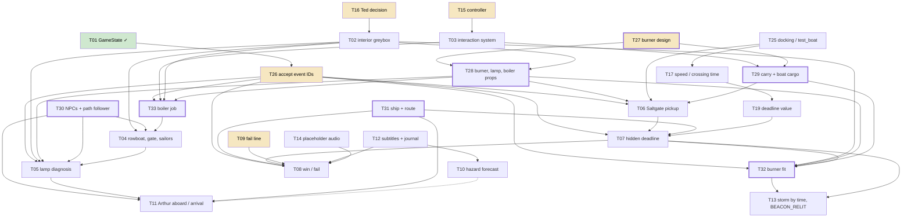

# GOA Dependency Order

**Project:** *Lighting the Storm* (Godot 4.3 / GDScript)
**Reviewed:** 2026-10-19, after the agent's first run and its T01 execution
**Inputs:** `README.md` (priority table), `BACKLOG.md` / `state/backlog.json`, `GOA Findings.md`, `DEVLOG.md`, `LightingTheStorm/HANDOFF_T01_GameState.md`, and a check of what is actually in `LightingTheStorm/`

## Why this document exists

The agent ranked its tasks by **score**: how much each one matters to the Gate 1 slice. A score is not a build order. Several score-10 tasks quietly depend on things that are not on the backlog at all, and some low-scoring tasks block high-scoring ones.

The clearest case is the burner. The story turns on a broken burner in the lamp and a replacement fetched from the Saltgate, and the agent's T01 work already made the return crossing wait for `BURNER_PICKED_UP`. But nothing on the backlog says what the burner is, makes one, lets the player pick it up and carry it, or puts it on the boat. T06 ("Burner pickup at the Saltgate, boat cargo") assumes all of that exists and lists only "Depends on GameState" as its blocker.

> **Update, 19 October 2026.** The creator answered the Wave 0 decisions:
> - **Closed:** T26, T27, T09 and T15.
> - **Done:** T25. The boat was fine; the test route was stale.
> - **Deferred:** T17. The boat stays at 10 m/s until the waves are complete.
> - **Narrowed:** T16 now covers only the lamp-room line list.
> - **Added:** T34, the discoveries decision, due Friday 23 October 2026.
>
> The answers are recorded as A17–A25 in the GDD's "Decisions to be made". The backup taken before they were applied is `state/backlog.before_creator_answers.json`.

## Contents

- [What is actually in the game today](#what-is-actually-in-the-game-today)
- [Tasks the backlog is missing](#tasks-the-backlog-is-missing)
- [Hidden dependencies between existing tasks](#hidden-dependencies-between-existing-tasks)
- [The burner thread, end to end](#the-burner-thread-end-to-end)
- [Dependency graph](#dependency-graph)
- [The build order](#the-build-order)
- [Corrections to the agent's own records](#corrections-to-the-agents-own-records)
- [Why the agent missed this](#why-the-agent-missed-this)

## What is actually in the game today

Checked by listing `LightingTheStorm/Assets`, `scripts/` and `ConceptArt/`:

| Needed by the story | In the game? | In the concept art? |
|---|---|---|
| Burner (broken, in the lamp) | No | No |
| Replacement burner at the Saltgate | No | No |
| Arc lamp / lantern assembly with a socket | No | No |
| Boiler, coal, gauge | No | No |
| Passenger ship | No | No |
| Sailors' rowboat | No (only `boat_launch.glb`) | Dock folder only |
| Arthur, Daniel | No (only `ted.glb` and the new rigged test character) | Yes (`ConceptArt/characters`) |
| Lighthouse interior | No (exterior glb only) | Yes (`narrative_blueprints`) |
| Saltgate quay | Yes (`saltgate_quay.glb`) | Yes |
| Player interaction or carrying | No. `player.gd` only walks, looks and drives the boat | n/a |
| NPC movement (walk a path, follow, sit aboard) | No | n/a |
| `GameState` autoload, phases, event bus, restart | **Yes** (T01 found it already existed) | n/a |
| Return crossing gated on the burner | **Yes**. `RETURN_DEPARTED` needs `BURNER_PICKED_UP`; F11 fakes the pickup | n/a |

## Tasks the backlog is missing

These are prerequisites that existing tasks assume but no task creates. They have been added to `state/backlog.json` as **T27–T33**, and every task now carries a `depends_on` list, a `build_wave` and a `build_order`. The pickup point at the Saltgate was folded into T06, which is really its scene half. The old backlog is kept at `state/backlog.before_dependency_pass.json`.

### T27 Decide what the burner is, and how it is carried (creator decision)

**Like I'm five.** Before anyone can build the spare part, someone has to say what it looks like, how big it is, and how you hold it.

**The work.** Decide: the burner's form (an arc-lamp burner assembly that fits the period and the style guide), whether it is carried in the hands or in a crate, how the broken one visibly differs from the spare, and how it is staged on the Saltgate quay. The staging has to respect the GDD rule *"Do not add significant detail to the Saltgate"*, so a single crate or a shelf on the quay is likely enough. Also decide whether the player can ever put it down outside the boat and the lamp. Saying no is the simplest way to keep the invariant that the burner is never permanently lost.

**Blocks:** T28, T29, T06, T32.

### T28 Burner, arc lamp and boiler props (greybox first)

**The work.** Make a broken burner sitting in the arc lamp, a spare burner (with its crate if T27 says so), the arc-lamp housing with a socket the burner fits into, and the boiler, coal pile and gauge for T33. Greybox primitives are fine for Gate 1. If FAL models come later through the Asset agent, run `main_asset.py --check-only` first and downscale the 4096 textures to 2048.

**Needs:** T27. The lamp props also need T02 (the lantern room to sit in).
**Blocks:** T33, T05, T06, T32.

### T29 Carry system: hold, stow aboard, take ashore

**Like I'm five.** The player needs hands. They pick the burner up, it rides on the boat, and they carry it up the stairs.

**The work.** An extension of T03's interaction system:
- The player holds one item.
- Boarding with an item stows it in a cargo slot on the boat, visible on the deck.
- The cargo survives `boat.gd` `_recover()` on a hazard hit.
- Disembarking at the lighthouse hands it back to the player.
- The item can only be released into a valid socket.

None of this exists. `player.gd` has no interaction code and `boat.gd` has no cargo.

**Needs:** T03 (the interaction system), T27.
**Blocks:** T06, T32.

### T06 (rewritten) Saltgate pickup point

**The work.** Place the spare burner (T28) on `saltgate_quay.glb` within walking reach of `DockZonePort`, check that the walk from the berth to the pickup and back is clear, and make picking it up fire `GameState.emit_event("BURNER_PICKED_UP")`. T06 has been rewritten to cover this; its old lighting change is already done (see corrections below).

**Needs:** T28, T29, T25 (the boat must reliably reach `DOCK_PORT`).

### T30 NPC placeholders and a path follower

**The work.** Placeholder Arthur and Daniel, the first use of the new rigged test character, and one small script that walks an NPC along a path, waits, follows the player, or sits at a seat on the boat. T04 (the sailors walk in, Daniel goes to the basement), T05 (Ted leads the player to the lantern room) and T11 (Arthur aboard) each assume this exists, and none of them builds it.

**Blocks:** T04, T05, T11.

### T31 Ship placeholder and its route

**The work.** A placeholder passenger ship, its lights, a path from the horizon toward the port, and the grounding point on the island rocks used by the fail. T07 mentions "ship placeholder" in passing, but the route and the grounding point, which T08's fail presentation and the lamp-room sightline (T02) depend on, are not specified anywhere.

**Blocks:** T07, T08, and the `SHIP_SIGHTED` part of T11.

### Splitting T08 and T03

T08 combined two jobs with different blockers, so it has been split in the backlog:

- **T32 Burner fit.** Carry the burner up to the lamp and fit it: `BURNER_FITTED`, then `BEACON_RELIT`. Needs T02, T28, T29.
- **T08 Outcomes.** Win or fail exactly once, foghorn, grounding, silence, the "Failed" screen, restart. Needs T07, T31, T09, T12, T14.

T03 has been split the same way:
- **T03** is now the generic interaction system only, which is code only.
- **T33** is the boiler job, which needs T02, T03 and T28.

## Hidden dependencies between existing tasks

Score order puts these the wrong way round:

| Task (score) | Must come before | Why |
|---|---|---|
| **T25** fix `test_boat.gd` and docking (5) | T06 (10), T07 (10) | The DEVLOG reports the outbound leg re-docks at `DOCK_LIGHTHOUSE` instead of reaching `DOCK_PORT`. If that is the boat and not the test (two berths share one `zone_id`), the player can't reliably reach the Saltgate, so the pickup and the clock start can't happen. Cheap to check, so do it first. |
| **T26** accept the event IDs (7) | T33, T05, T06, T07, T08 | They all emit `RETURN_ARRIVED`, `BURNER_FITTED`, `SHIP_WIN` and `SHIP_FAIL`, or depend on the phase boundaries. A rename after they are built touches every one of them. |
| **T12** subtitles and journal UI (7) | Any playtest of T04, T05, T11, and T08 | No audio plays yet, so without subtitles every dialogue beat is invisible. T08's "Failed" reason line and T09's audio-only alternative also need a text layer. |
| **T16** Ted's presence (7) | T02, T05, T32 | It decides how Ted is staged at the door, in the lantern room and at the lamp. |
| **T14** placeholder audio (6) | T08 | The fail is defined by a foghorn and the silence after it. |
| **T17** boat speed and crossing time (6) | T19 (5), then T07's real value | `Level.tscn` uses 10 m/s and the spec says 3 m/s. The deadline length only means something once the crossing time is known. T07 can still be built against a labelled placeholder. |
| **T15** controller decision (6) | T03's prompts | It decides whether interaction prompts need gamepad glyphs. Small, but cheaper to decide before the prompt code exists. |
| T13 storm follows time (7) | Needs T07 **and** T32 | `BEACON_RELIT` is triggered by `BURNER_FITTED`, which T32 creates. The backlog lists only T07. |

## The burner thread, end to end

This is the chain the user spotted, with every link named:

```
T27 decide the burner (creator)
 ├─► T28 props: broken burner in the arc lamp, spare at the Saltgate, lamp socket
 │     └─ the lamp props need T02 (lantern room)
 └─► T03 interaction system ─► T29 carry / stow aboard / take ashore

T05  diagnosis: Ted opens the arc lamp and the broken burner is found  (T28, T02, T30)
T25  boat reliably docks at DOCK_PORT
T06  pick up the spare at the Saltgate ─► BURNER_PICKED_UP
            (T28, T29, T25; then remove the F11 stand-in)
 └─► cast off from DOCK_PORT ─► RETURN_DEPARTED   (already in GameState)
       └─► T07 hidden deadline starts (T31 ship)
             └─► disembark at the lighthouse, carry the burner up the stairs (T29, T02)
                   └─► T32 fit it in the socket ─► BURNER_FITTED ─► T13 BEACON_RELIT
                         └─► T08 win, or the deadline wins first ─► fail
```

What T01 already did for this thread: the `GameState` side of the burner works. `burner_aboard`, the `BURNER_PICKED_UP` → `RETURN_DEPARTED` gate and the RETURN lighting are all in place. What's missing is everything physical: the object, hands to hold it, and a place to put it on the boat and in the lamp.

## Dependency graph

An arrow means "must exist first". Thick outlines are the tasks added in this pass (T27–T33); shaded nodes are creator decisions; green is done.



Dotted and soft links: `T10 -.-> T11` covers only Arthur's navigation calls (T11 part 3). `T07 --> T32` is also soft: the fit can be built before the clock, but it can't be tested under pressure without it. `T17 --> T19 --> T07` is also soft, since T07 ships with a placeholder value and gets tuned afterwards.

## The build order

Each wave only needs what the waves before it produced. Within a wave the tasks are independent and can run in parallel.

### Wave 0: decisions and bookkeeping (creator time, no code)

| Step | Task | Who | Why now |
|---|---|---|---|
| 0.1 | ~~Mark T01 done in `state/backlog.json`; fix the stale "no [autoload]" evidence~~ **Done** in this pass (R10 and R15 had already been re-scored by the T01 run) | Agent | The backlog said the foundation was missing |
| 0.2 | **T26** accept or rename the four event IDs and phase boundaries | Creator | Everything downstream emits them |
| 0.3 | **T27** decide the burner, its carry and its Saltgate staging | Creator | Nothing physical in the burner thread can start without it |
| 0.4 | **T16** lock Ted's presence | Creator | Blocks the interior staging |
| 0.5 | **T09** fail line wording and deliverer | Creator | Blocks T08; quick |
| 0.6 | **T15** controller yes or no | Creator | Settles the prompt format before T03 |

### Wave 1: foundations the agent can build without the editor

| Step | Task | Why now |
|---|---|---|
| 1.1 | **T25** find out why the outbound leg re-docks at the lighthouse; make the test fail on a timeout | The Saltgate has to be reachable before anything happens there |
| 1.2 | **T03** generic interaction system (raycast, prompt, `interact`) | Template for the boiler, gate, burner and lamp |
| 1.3 | **T29** carry system and boat cargo slot | The burner's hands and its seat on the boat |
| 1.4 | **T12** subtitle and journal UI | Makes every beat after this visible in a playtest |
| 1.5 | **T21** gate the debug label and F-keys | Cheap; do it while touching `lighting_rig.gd` |
| 1.6 | **T17** reconcile the 10 vs 3 m/s speed and time a crossing (creator playtest) | Feeds T19; can run alongside |

### Wave 2: spaces, props and actors (mostly editor work)

| Step | Task | Needs |
|---|---|---|
| 2.1 | **T02** interior greybox: door, hall, basement, stairs, lantern room, both windows | T16 |
| 2.2 | **T28** burner (broken and spare), arc lamp with socket, boiler, coal, gauge | T27, T02 for placement |
| 2.3 | **T30** Arthur and Daniel placeholders, rowboat, path-follower script | none |
| 2.4 | **T31** ship placeholder, approach route, grounding point | none (check the sightline against T02) |

### Wave 3: the beats, in story order

| Step | Task | Event(s) it makes real | Needs |
|---|---|---|---|
| 3.1 | **T33** boiler job | `LIGHTHOUSE_ENTERED`, `BOILER_FED` | T02, T03, T28 |
| 3.2 | **T04** window, rowboat, gate, sailors walk in | `SAILORS_MOORED`, `GATE_OPENED`, `DANIEL_IN_BASEMENT` | T02, T30, T33 (story order) |
| 3.3 | **T05** lantern-room diagnosis with the broken burner | `BEACON_STILL_DARK`, `LAMP_ROOM_ENTERED`, `BURNER_DIAGNOSED`, `BURNER_BRIEFING` | T02, T04, T28, T30 |
| 3.4 | **T11 (part 1)** Arthur boards; ship sighted at the threshold | `BOARDING_THRESHOLD` | T30, T31 |
| 3.5 | **T06** spare burner pickup at the Saltgate, stowed aboard; **remove the F11 stand-in** | `BURNER_PICKED_UP` → `RETURN_DEPARTED` | T28, T29, T25 |

After 3.5 the slice is playable from the door to the return departure with no debug keys.

### Wave 4: the stakes and the ending

| Step | Task | Needs |
|---|---|---|
| 4.1 | **T19** labelled placeholder deadline value | T17 if available, else a guess marked as one |
| 4.2 | **T07** hidden deadline, ship approach, debug time scale | T06, T31, T19 |
| 4.3 | **T32** carry the burner ashore, up the stairs, fit it | T02, T28, T29 |
| 4.4 | **T13** storm cues follow elapsed time; `BEACON_RELIT` and the beam sweep | T07, T32 |
| 4.5 | **T14** placeholder audio, the foghorn at minimum | none, but needed by 4.6 |
| 4.6 | **T08** win or fail exactly once, the "Failed" screen, restart | T07, T31, T09, T12, T14 |
| 4.7 | **T11 (part 2)** Arthur's "go go go" arrival line on `RETURN_ARRIVED` | T07 |

After 4.6 the Gate 1 slice can be played end to end, win or lose.

### Wave 5: crossing quality, verification, polish

| Step | Task |
|---|---|
| 5.1 | **T10** crew hazard forecast in the sea: buoys and debris, return harder than outbound |
| 5.2 | **T11 (part 3)** Arthur's navigation calls from the same safe-lane signal |
| 5.3 | **T17 → T19** tune the speed and the real deadline length from playtests |
| 5.4 | **T20** QA scenario list and headless state checks |
| 5.5 | **T18** review and re-record the six voice lines, then hook up audio playback |
| 5.6 | **T22** game readme and handoff template |
| 5.7 | **T23** bake the mainland to cut load time |
| 5.8 | **T24** walkway teeth and darkness (deferred) |

### The critical path

The longest chain, which sets the earliest date the slice can be finished:

**T16 → T02 → T28 → T05 … T06 → T07 → T32 → T08**

T02 (the interior, editor work, effort L) sits on almost every path. It's the single biggest schedule risk, so it should start as soon as T16 is decided, in parallel with all of Wave 1.

## Corrections to the agent's own records

- **T01 was effectively done but still "open".** The DEVLOG said so and asked for `state/backlog.json` to be updated. It is now marked done and its stale "no [autoload]" evidence is corrected.
- **Part of T06 was already done.** T06 asked to "change `lighting_rig.gd` so RETURN depends on the burner event". `GameState` already does this, so T06 has been rewritten as the pickup only (`require_burner_for_return`, and `follow_boat_signals = false` on the rig). The comment on `lighting_rig.gd:137` ("leaving the Saltgate means the burner is aboard") is now misleading but has no effect.
- **The F11 stand-in has to come out** (or stay debug-only) once T06 fires the real `BURNER_PICKED_UP`.
- **The README's dependency graph** (`GOA Findings.md`, "How the findings depend on each other") has no node for the burner object, carrying, the NPC movement or the ship route. It also has T01 blocking T06 when the real blockers are T28, T29 and T25.

## Why the agent missed this

This is worth noting for the assignment:

1. **Tasks come from requirement gaps, not from a bill of materials.** The analysis asks "which requirement is unmet?" (R09: no burner pickup in any script) and writes a *code* task to close it. It never asks "what objects does this beat need, and do they exist?", so the burner, the ship route and the NPC movement fall through.
2. **"Blocked by" is free text.** Dependencies are written as prose ("Depends on GameState"), so nothing checks that the blocker is itself a task, or that a score-10 task isn't waiting on a score-5 one (T25).
3. **Scores sort the list.** The proposal screen shows tasks by score. Without a dependency check, picking the top item can mean picking something that can't be built yet. T01 was a lucky exception, since it turned out to be finished already.

Three possible fixes to the agent:
- **Flag any open task whose dependencies are still open.** Done in this pass. Tasks carry `depends_on`. The CLI task list shows `[waiting on T..]`, and `BACKLOG.md` has a "Build order" table with a "Waiting on" column (`goa/state.py` `waiting_on()`, `goa/docs.py`, `main.py`).
- **Ask the model for `depends_on`.** Not done yet. Add a `depends_on: [task ids]` field to the `submit_analysis` schema in `goa/prompts.py` so new analyses fill it, and sort the proposal list topologically, then by score.
- **Add an "assets and actors each beat needs" pass to the analysis prompt.** Not done yet.

**Caution:** `rescan` throws away every open task, including T27–T33 and all the dependency data. Until the schema fix above is in, re-apply this pass after a rescan, or avoid rescanning.
