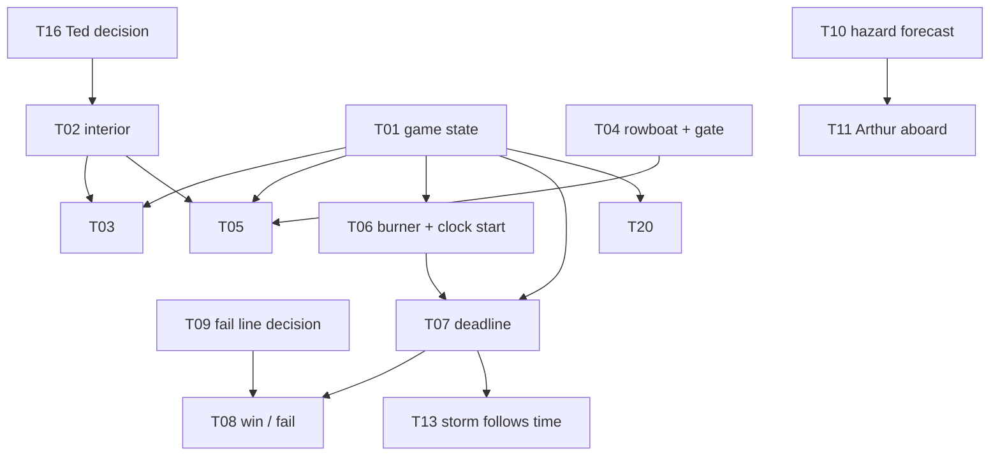

# GOA Findings

**Project:** *Lighting the Storm* (Godot 4 / GDScript)
**Produced by:** the Goal-Oriented Coding Agent in `GoalOrientedAgent/`, first live run, 2026-10-19
**Source of every finding:** `state/backlog.json` (rendered as `BACKLOG.md`) and the session logs in `logs/`


``` 
Prompt : Create an MD document which describes all of the findings. Name it "GOA Findings" - I will be submitting this to my assignment.

Include a table of contents at the top so I can survey the findings, then provide a header/body section for each finding, with the body containing (to start) an "explain what I'm proposing like the reader is five", then include the actual work, expected outcome, and any cost implications.
```

## What this document is

The agent read the GDD (Exec Summary, Technical Strategy, AI Agent Strategy), the concept art, the AI crew briefs and the game project, then compared what the design promises with what the game contains. It reported **21 requirements** for the Gate 1 vertical slice, of which **1 is met, 9 are partial and 11 are unmet (26% of the goal)**. It then turned the gaps into **24 findings**, each scored out of 10.

**Score key:** 10 = absolute must (the slice cannot be played end to end without it) · 8-9 = needed to pass a Gate 1 exit test or unblock other work · 6-7 = important, but the slice runs without it · 4-5 = polish or documentation that will matter soon · 2-3 = nice to have, later gates · 1 = not required at all.

**How to read each finding:** every finding has the same four parts: *Explain it like I'm five*, *The actual work*, *Expected outcome* and *Cost implications*.

**About the cost figures.** These are estimates, not measurements, and no prices are quoted. Costs come in three kinds:
- **Agent cost:** model tokens to plan and execute the task. *Low* is one short session, *Medium* a longer session with many file reads and edits, *High* more than one session. Planning is read-only and cheap compared with execution.
- **Creator time:** your time to decide, review a diff, or play-test in the Godot editor. The agent cannot run the editor, so anything marked "needs you" always costs creator time.
- **External cost:** things outside the agent, such as voice-generation credits or audio licences.

## Table of contents

**Overview**
- [Headline findings](#headline-findings)
- [Requirements scorecard](#requirements-scorecard)
- [The 24 findings at a glance](#the-24-findings-at-a-glance)

**Findings, highest score first**

| # | Score | Finding |
|---|---|---|
| 1 | 10 | [T01 Central game state controller](#t01-central-game-state-controller) |
| 2 | 10 | [T02 Lighthouse interior greybox](#t02-lighthouse-interior-greybox) |
| 3 | 10 | [T06 Burner pickup and the return-trip clock start](#t06-burner-pickup-and-the-return-trip-clock-start) |
| 4 | 10 | [T07 Hidden ship deadline](#t07-hidden-ship-deadline) |
| 5 | 10 | [T08 Win and fail outcomes](#t08-win-and-fail-outcomes) |
| 6 | 9 | [T03 Interaction system and the boiler coal job](#t03-interaction-system-and-the-boiler-coal-job) |
| 7 | 9 | [T04 Rowboat, island gate and the sailors' arrival](#t04-rowboat-island-gate-and-the-sailors-arrival) |
| 8 | 9 | [T05 Lantern room diagnosis](#t05-lantern-room-diagnosis) |
| 9 | 8 | [T09 Decide the fail reason line](#t09-decide-the-fail-reason-line) |
| 10 | 8 | [T10 Connect the crew's hazard forecast to the sea](#t10-connect-the-crews-hazard-forecast-to-the-sea) |
| 11 | 7 | [T11 Arthur aboard and the arrival beat](#t11-arthur-aboard-and-the-arrival-beat) |
| 12 | 7 | [T12 Subtitles and journal on screen](#t12-subtitles-and-journal-on-screen) |
| 13 | 7 | [T13 Storm that follows time, and the beacon relit](#t13-storm-that-follows-time-and-the-beacon-relit) |
| 14 | 7 | [T16 Lock Ted's presence](#t16-lock-teds-presence) |
| 15 | 6 | [T14 Placeholder audio](#t14-placeholder-audio) |
| 16 | 6 | [T15 Controller support decision](#t15-controller-support-decision) |
| 17 | 6 | [T17 Steering go/no-go and boat speed mismatch](#t17-steering-gono-go-and-boat-speed-mismatch) |
| 18 | 5 | [T19 Placeholder deadline length and penalties](#t19-placeholder-deadline-length-and-penalties) |
| 19 | 5 | [T20 QA scenarios and state checks](#t20-qa-scenarios-and-state-checks) |
| 20 | 4 | [T18 Review and re-record six voice lines](#t18-review-and-re-record-six-voice-lines) |
| 21 | 4 | [T22 Game readme and handoff template](#t22-game-readme-and-handoff-template) |
| 22 | 3 | [T21 Hide the debug display](#t21-hide-the-debug-display) |
| 23 | 3 | [T23 Cut the level load time](#t23-cut-the-level-load-time) |
| 24 | 2 | [T24 Walkway rock wall and darkness](#t24-walkway-rock-wall-and-darkness) |

**Closing**
- [How the findings depend on each other](#how-the-findings-depend-on-each-other)
- [What the agent could not judge](#what-the-agent-could-not-judge)

---

## Headline findings

The agent's overall verdict: *the game is a strong technical spike for the sea and the world, but it is not yet a playable Gate 1 slice.* What works today is a first-person walker, a boat with one fixed speed and one steering axis, automatic docking and hit recovery, a large greybox world and a storm lighting rig. What is missing is nearly everything that turns it into a game: no state controller, no interior, no deadline, no ending.

Three discoveries were new to the creator's own list (`things to work on next.md`):

1. **Nothing in the level triggers the dialogue.** `DialogueLoader` is not even in `Level.tscn`, and no code calls `DialogueLoader.trigger()`. The dialogue data and the loader work when driven by hand, but a player will never hear a line. (Feeds T01.)
2. **The boat speed disagrees with its own spec.** `Level.tscn` sets the boat to 10.0 m/s while `data/world/boat_spec.json` says 3.0. The route is about 500 m, so the crossing time the GDD plans around depends on which number is true. (T17.)
3. **The crew's output is not used by the game.** `AIAgentCrew/output/return_crossing.json` and `AIAgentCrew/godot/crossing_loader.gd` exist, but nothing in `LightingTheStorm/` references them. The hazards in the sea today are static rocks and cliffs only. (T10.)

## Requirements scorecard

| ID | Status | Requirement (short) |
|---|---|---|
| R01 | Unmet | Start outside the lighthouse; Ted opens the door |
| R02 | Unmet | Player feeds the boiler with coal |
| R03 | Unmet | Rowboat, island gate, sailors walk in, Daniel stays in basement |
| R04 | Unmet | Dynamo runs, beacon stays dark, Ted finds the burner broken |
| R05 | Partial | Boarding: Arthur at the boat, ship named at the threshold |
| R06 | **Met** | Boat: one axis, one fixed speed, auto-dock, recovery on a hit |
| R07 | Partial | Readable hazards with one shared forecast and safe-route signal |
| R08 | Partial | Outbound and return crossings playable end to end |
| R09 | Unmet | Pick up the replacement burner at the Saltgate |
| R10 | Unmet | One hidden deadline that starts once, on return departure |
| R11 | Partial | Storm split: feel follows time, hazards follow position |
| R12 | Unmet | Climb to the lamp and fit the burner; Arthur's arrival line |
| R13 | Unmet | Win and fail resolve exactly once; "Failed" screen with a reason |
| R14 | Partial | Restart the slice after a fail |
| R15 | Unmet | Explicit phase state machine with stable event IDs |
| R16 | Partial | Guidance by voice, subtitle and journal; no markers, no timer |
| R17 | Unmet | Keyboard and controller, with prompts |
| R18 | Unmet | Placeholder audio mixed by phase |
| R19 | Partial | Warm lamp against blue-grey storm; legible beacon and hazards |
| R20 | Partial | Scope and hard rules respected |
| R21 | Partial | Handoffs, JSON data with stable IDs, documented engine |

## The 24 findings at a glance

| Score band | Count | What they are |
|---|---|---|
| 10 | 5 | The spine of the slice: state controller, interior, burner trigger, deadline, endings |
| 8-9 | 5 | The story beats between them, plus the fail-line decision and hazard integration |
| 6-7 | 7 | Companion, subtitles, storm cues, audio, controller and steering decisions |
| 4-5 | 4 | QA, deadline numbers, voice re-recording, documentation |
| 2-3 | 3 | Debug display, load time, walkway polish |

---

## T01 Central game state controller

**Score 10/10** · code · Gameplay / Systems agent · effort M · the agent can do this one

**Explain it like I'm five.** Imagine a board game with no one keeping track of whose turn it is. The pieces are all there, but nobody says "now it's time for the next part." This task adds the person who keeps track and shouts "next!" at the right moment, so the lights, the voices and the boat all know what part of the story we are in.

**The actual work.** Add one always-loaded script (`scripts/core/game_state.gd`, registered as an autoload in `project.godot`) that holds the story phases from the Technical Strategy, a single place where story events are announced (with a debug log), and a `restart()`. It adopts the existing `DialogueLoader`, forwards events to `trigger()`, and drives the lighting rig and boat signals. In the live plan the agent kept to event IDs that already exist in `AIAgentCrew/canon.py` and flagged that the GDD does not say which event begins the BOARDING phase, so it did not invent one. A full plan for this task is in `logs/session_20261019_140415.md`.

**Expected outcome.** Every other Gate 1 task can plug into one contract instead of each inventing its own. Requirements R14 (restart), R15 (state machine) and R10 (deadline) move from unmet or partial towards met. The opening dialogue becomes triggerable.

**Cost implications.** Agent: medium (about 15 read calls to plan, then a handful of new and edited files). Creator: low, one diff review and one launch of the level. External: none. Risk: it touches the boat and the lighting rig, so a wrong hook could break the one requirement that is currently met (R06), which is why undo is available. This is the cheapest way to unlock six other findings.

---

## T02 Lighthouse interior greybox

**Score 10/10** · scene · Level Layout agent · effort L · needs you

**Explain it like I'm five.** The lighthouse is currently a painted wall with nothing behind it. The story happens inside: a door, a hall, a basement with the boiler, stairs and the lamp at the top. This task builds the rooms out of plain grey boxes so the player can walk through them.

**The actual work.** Build a greybox interior following `ConceptArt/narrative_blueprints/Brussskania Lighthouse Blueprint Poster.png`: entrance door, entry hall, basement boiler room, tower stairs, lantern room, a window with a view of the dock, and a lantern-room window with a clear sightline to the ship route. Move the player start to outside the door and add interaction anchors for the other tasks.

**Expected outcome.** Beats 1-4 and the ending can physically happen. R01 can become met. Sightline checks for the final beat become possible.

**Cost implications.** Agent: medium to high, because scene files are large and fiddly to edit as text. Creator: **high**, since placing rooms, checking scale and walking the sightlines needs the Godot editor and cannot be verified by the agent. External: none. Depends on the Ted decision (T16) for how Ted is staged. Likely the largest single time cost on the list.

---

## T06 Burner pickup and the return-trip clock start

**Score 10/10** · code · Gameplay / Systems agent · effort M

**Explain it like I'm five.** The player has to fetch a special part from the far harbour. The moment they leave with it, a secret clock starts ticking. Right now the game starts the "return trip" the moment the boat leaves that harbour even if the player brought nothing back. This task makes the part real and makes it the thing that starts the clock.

**The actual work.** Add a burner pickup at the Saltgate quays, carry it as cargo on the boat so a collision can never lose it, and emit `RETURN_DEPARTED` only when the boat casts off from `DOCK_PORT` with the burner aboard. Change `scripts/world/lighting_rig.gd` (line 131) so the RETURN phase depends on that event instead of any departure.

**Expected outcome.** R09 moves to met and the hidden clock (R10) has a correct starting point, which the GDD lists as a Gate 1 acceptance item.

**Cost implications.** Agent: medium. Creator: low to medium (play the outbound trip, pick up, return). External: none. Blocked by T01.

---

## T07 Hidden ship deadline

**Score 10/10** · code · Gameplay / Systems agent · effort M

**Explain it like I'm five.** There is a big ship coming that will crash unless the lighthouse is lit in time. The player must never see a countdown, but the game needs a secret one. This task adds the secret stopwatch and a toy ship that gets closer as time runs out.

**The actual work.** Implement an internal numeric deadline with no on-screen timer, paused in menus and inactive until the return trip starts. Add a placeholder ship whose lights wait at the horizon and then approach. Add a debug time-scale and event log so testers can skip ahead. The deadline length is a placeholder constant until play-tests settle it.

**Expected outcome.** R10 becomes met and the story has stakes: a way for the player to lose. The storm cues (T13) and endings (T08) can hang off the clock.

**Cost implications.** Agent: medium. Creator: low to medium, mostly reviewing that the placeholder value feels workable. External: none. Depends on T01 and T06. The final deadline value is deliberately left to the creator (see T19).

---

## T08 Win and fail outcomes

**Score 10/10** · code · Story / Fail-State agent · effort L · needs you

**Explain it like I'm five.** Every game needs a happy ending and a sad ending. If the player fits the part in time, the ship sails safely past. If not, there is a horn, a crash, silence, and a screen that says "Failed" and tells them why. Right now there is neither ending.

**The actual work.** Add the burner-fit interaction at the lamp with Ted waiting there, then resolve WIN or FAIL exactly once. A fail plays foghorn, grounding, silence and a title screen with a reason line, then restarts the slice. It covers the three places the deadline can expire: the crossing, the lamp room and the stairs, each with a visual or subtitle alternative to audio-only cues.

**Expected outcome.** Both outcomes and restart, which are explicit Gate 1 acceptance items. R12, R13 and R14 can become met.

**Cost implications.** Agent: high (new UI, audio hooks, several scenes). Creator: **high**. It is blocked by two open creator decisions (T09: the fail line and its deliverer, and the audio-only alternative), and the lamp-room sightline needs editor checks. External: sound assets (see T14).

---

## T03 Interaction system and the boiler coal job

**Score 9/10** · code · Gameplay / Systems agent · effort M

**Explain it like I'm five.** Right now the only thing the player can touch is the boat. This task teaches the player to press a button on things, and the first thing they touch is the boiler: shovel coal until the dial goes up and the lighthouse's machine hums.

**The actual work.** Add a generic first-person interactable (using the existing `interact` action, currently read only by `boat.gd`) with a short diegetic text prompt, no quest markers. Build the boiler job on it so it emits `BOILER_FED`.

**Expected outcome.** R02 becomes met, and the same interactable is reused for the gate, the burner and the lamp.

**Cost implications.** Agent: medium. Creator: low to medium (play-test the shoveling). External: none. Depends on T01 and the interior (T02).

---

## T04 Rowboat, island gate and the sailors' arrival

**Score 9/10** · scene · Level Layout agent · effort L · needs you

**Explain it like I'm five.** Two sailors arrive in a little rowboat in the storm. Ted sees them from the window, the player lets them in through the gate, and one of them goes to hide in the basement. This task puts the rowboat, the gate and the two walking sailors into the world.

**The actual work.** Add a rowboat visibly different from the engine boat at the island dock, trigger the window moment (`SAILORS_MOORED`) with a time fallback, make the existing island gate (`1-gate.glb`) one interaction, and script Arthur and Daniel walking to the lighthouse with Daniel ending in the basement (`DANIEL_IN_BASEMENT`). Placeholder capsules are acceptable for the sailors; concept art is in `ConceptArt/characters` and `ConceptArt/dock`.

**Expected outcome.** R03 becomes met and unlocks the lantern-room beat (T05).

**Cost implications.** Agent: medium to high. Creator: high, because the rowboat, gate and walking paths need the editor. There is no rowboat, Arthur or Daniel mesh in the project yet, so placeholders (or new generated models, which would be an external cost) are needed.

---

## T05 Lantern room diagnosis

**Score 9/10** · code · Gameplay / Systems agent · effort M

**Explain it like I'm five.** Ted leads the player up to the top, opens the big lamp, and finds the special part is broken. That is the reason the player has to make a dangerous trip across the water.

**The actual work.** Implement the `BEACON_DIAGNOSIS` trigger so it can only fire after `DANIEL_IN_BASEMENT`, with Ted leading the player to the lantern room, the arc lamp opening, then `BURNER_DIAGNOSED` and `BURNER_BRIEFING`. Reuse the lines already in `data/dialogue/dialogue_opening.json` (TED_S3_00 to TED_S3_02).

**Expected outcome.** R04 becomes met and the story correctly sends the player to the Saltgate.

**Cost implications.** Agent: medium. Creator: low to medium. External: none. Depends on T01, T02 and Ted being in the scene (T16).

---

## T09 Decide the fail reason line

**Score 8/10** · decision · Canon and Review Orchestrator · effort S · needs you

**Explain it like I'm five.** When the player loses, the game should tell them why in one short sentence, and someone has to say it. Only the person who owns the story, the creator, can choose the words and who says them. The agent is not allowed to guess.

**The actual work.** The creator chooses (a) the wording of the line shown on "Failed", (b) who delivers it (Ted, Arthur or the journal), and (c) what subtitle or visual replaces the audio-only fail cue on the crossing and stairs. These are items B3 and B8 in `Decisions to be made.md`. The agent can draft options for the creator to choose between.

**Expected outcome.** Unblocks T08 and satisfies Pillar 4: the player is told why they failed.

**Cost implications.** Agent: low (drafting options only). Creator: low, a short decision. External: none. High value for little cost, which is why it scores 8 even though it is small.

---

## T10 Connect the crew's hazard forecast to the sea

**Score 8/10** · code · Hazard Forecast agent · effort M

**Explain it like I'm five.** The AI crew already drew a map of where the rocks and buoys should go and what Arthur should shout. But nobody gave that map to the game. This task hands it over.

**The actual work.** Copy `return_crossing.json` into `LightingTheStorm/data`, add `crossing_loader.gd` to the scene with a route-position feed from the boat, spawn the hazards (rocks, buoys, debris) from it, and play Arthur's calls as subtitles from the same safe-lane signal. Add an easier outbound forecast. No waves and no route branching (both out of scope per the GDD).

**Expected outcome.** R07 and R08 move toward met: readable hazards, one safe route, and Arthur's calls that never disagree with the world.

**Cost implications.** Agent: medium. Creator: medium, since steering feel and call timing need a play check. External: none. The crew data already exists, so most of the cost is wiring, not design. Best done after Arthur is aboard (T11).

---

## T11 Arthur aboard and the arrival beat

**Score 7/10** · code · Gameplay / Systems agent · effort M

**Explain it like I'm five.** Arthur rides in the boat and talks to the player. When they get back he shouts "go, go, go, don't wait for me" and the player runs for the lighthouse.

**The actual work.** Seat Arthur on the engine boat as the only companion, fire `BOARDING_THRESHOLD` (Ted introduces the ship), fire `SALTGATE_REACHED` and the arrival events from the dock zones, and play his arrival line on the return.

**Expected outcome.** R05 moves toward met; the companion-guidance pillar becomes visible in play.

**Cost implications.** Agent: medium. Creator: low to medium. External: none, though an Arthur placeholder model is needed (shared with T04). Depends on T01 and T10.

---

## T12 Subtitles and journal on screen

**Score 7/10** · code · Dialogue agent · effort M

**Explain it like I'm five.** The characters can "speak" in the game's data, but there is nowhere on screen to show the words, and no notebook to write down what the player should do next. This task adds both.

**The actual work.** Add a `CanvasLayer` with speaker-attributed subtitles driven by the loader's `line_started` signal, and a handwritten-style journal driven by `journal_entry_added`. No quest markers, no timer; the assist hint stays off by default.

**Expected outcome.** R16 moves toward met: guidance reaches the player and the accessibility requirement (subtitles with speaker names) is satisfied.

**Cost implications.** Agent: medium. Creator: low to medium (typography and readability are a matter of taste). External: none. The signals currently have no listeners, so this is mostly self-contained.

---

## T13 Storm that follows time, and the beacon relit

**Score 7/10** · code · Lighting agent · effort M

**Explain it like I'm five.** The longer the player takes, the angrier the storm should look and sound, but the rocks must not get harder to see just because time passed. This task makes the weather follow the clock, and makes the lighthouse beam sweep when the light finally comes on.

**The actual work.** In `lighting_rig.gd`, blend rain, lightning, wind and ship lights by normalised elapsed deadline time while hazard density and visibility stay tied to route position. Add the `BEACON_RELIT` trigger (it has none today) and a beam sweep.

**Expected outcome.** R11 and R19 move toward met; the "storm split" decision from the GDD is honoured.

**Cost implications.** Agent: medium. Creator: medium, since "does it feel tense" can only be judged by looking. External: none. Depends on T07.

---

## T16 Lock Ted's presence

**Score 7/10** · decision · Canon and Review Orchestrator · effort S · needs you

**Explain it like I'm five.** Ted is the old keeper. The plan says to decide, by the end of week 3, whether he is really there and talks, and which of his last lines are worth recording. Every recorded line costs money, so the creator has to pick.

**The actual work.** Confirm that Ted is present and speaks live, and settle the final lamp-room line list. This is item B1 in `Decisions to be made.md`; `Assets/Characters/ted.glb` already exists.

**Expected outcome.** Unblocks Ted's staging (T02, T05, T08) and the voice budget.

**Cost implications.** Agent: low. Creator: low. External: every extra recorded line is a voice-generation credit, so the decision directly controls that spend.

---

## T14 Placeholder audio

**Score 6/10** · audio · Sound agent · effort M · needs you

**Explain it like I'm five.** There is no sound at all. The storm, the boiler, the bells and the foghorn are how the player *feels* time running out, because there is no timer on screen.

**The actual work.** Add audio buses and `AudioStreamPlayer`s for wind, rain, boiler and dynamo, buoy bells, foghorn and ship impact, mixed by phase with Arthur's calls kept audible. Record the source and licence for every file.

**Expected outcome.** R18 becomes met at placeholder quality, which the GDD accepts for Gate 1.

**Cost implications.** Agent: medium. Creator: medium, because sound choices need your ears. External: **needs sound files and licences**; there are no audio assets in the project today.

---

## T15 Controller support decision

**Score 6/10** · decision · Player Movement agent · effort M · needs you

**Explain it like I'm five.** Two of the design papers disagree. One says "make it work with a game controller now," the other says "later." Someone has to say which is right before anyone builds it.

**The actual work.** Decide item B14. If yes, add joypad bindings for steer, interact and look, gamepad look in `player.gd`, and button-glyph prompts in the boat label. Today `project.godot` has keyboard bindings only and `player.gd` uses mouse look only.

**Expected outcome.** R17 is either met or formally moved to a later gate, which also removes a contradiction from the documents.

**Cost implications.** Agent: low if "later", medium if "now". Creator: low to decide, medium to test with a controller. External: none (a physical controller is needed to test).

---

## T17 Steering go/no-go and boat speed mismatch

**Score 6/10** · test · Boat / Physics agent · effort M · needs you

**Explain it like I'm five.** The boat's speed is written down as slow in one place and fast in another. Before building more, someone must drive the boat across and say whether it feels good.

**The actual work.** Resolve the 10.0 m/s (`Level.tscn`) versus 3.0 m/s (`boat_spec.json`) conflict. Play both crossings, record crossing times against the 10-minute slice target, tune speed, steering and recovery as data, and write the go/no-go decision for the creator.

**Expected outcome.** A single trusted speed, and a recorded decision on the biggest production risk named in the Technical Strategy.

**Cost implications.** Agent: low to medium (comparing numbers, writing the report). Creator: **medium to high**, because feel can only be judged by a human playing. External: none. If the answer is "no-go," this is the cheapest moment to find out.

---

## T19 Placeholder deadline length and penalties

**Score 5/10** · decision · Production Orchestrator · effort S · needs you

**Explain it like I'm five.** How long does the player get, and how much time does bumping a rock cost? The designers deliberately left this blank until they can try it. This task writes down a clearly labelled "temporary guess" so testing has something to measure against.

**The actual work.** Record a placeholder deadline, the outbound-crossing penalty (B9, deferred) and the collision cost, for the QA tuning pass. This is items B4, B9 and B11 in `Decisions to be made.md`.

**Expected outcome.** Numbers exist to compare against, and the tuning pass can start.

**Cost implications.** Agent: low. Creator: low, but it can only be settled after the crossing is playable (T10, T17). External: none.

---

## T20 QA scenarios and state checks

**Score 5/10** · test · QA agent · effort M

**Explain it like I'm five.** A checklist so we can prove the game works, plus little robot tests that run it and say pass or fail.

**The actual work.** Write a reproducible scenario list for each phase change, the clock starting once, the outcome resolving exactly once, restart, each fail location and a keyboard and controller pass. Add headless GDScript checks beside the existing `tools/test_boat.gd` where practical.

**Expected outcome.** Gate checks have evidence, not opinion. Guards against regressions as the other tasks land.

**Cost implications.** Agent: medium. Creator: low. External: none. It only pays off once the state controller (T01) exists, which is why it is a 5.

---

## T18 Review and re-record six voice lines

**Score 4/10** · dialogue · Dialogue agent · effort M · needs you

**Explain it like I'm five.** Six sentences were rewritten when the story order changed, but their recordings still say the old words, and one new line has no recording. The new lines need a check, then new recordings.

**The actual work.** Run TED_S1_01, S1_09, S1_10, S1_11, S3_02, ARTHUR_S3_04 and the new TED_S3_00 through Dialogue and Canon review and the creator's sign-off, record the outcome in `DIALOGUE_OPENING_CREATOR_PICKS.md`, then regenerate the audio with `main_elevenlabs.py` (dry run first). The playback hook in the game comes later.

**Expected outcome.** Recorded voices match the final script, so nothing is wasted when audio is wired in.

**Cost implications.** Agent: medium. Creator: medium (reviewing and approving lines). External: **ElevenLabs credits** for seven lines, only spent on the `--send` run. Nothing breaks if this waits, because the game plays no line audio yet.

---

## T22 Game readme and handoff template

**Score 4/10** · doc · Production Orchestrator · effort S

**Explain it like I'm five.** The game folder's instruction booklet is blank. This writes the booklet so the next helper, human or AI, knows how to run it.

**The actual work.** Fill the empty `LightingTheStorm/readme.md` with engine version (4.3 Forward Plus per `project.godot`), how to run, controls, event IDs and scene ownership. Add a per-task `HANDOFF.md` template. Flag the controller contradiction (T15) and the unconfirmed week-5 fallback wording for the creator.

**Expected outcome.** R21 moves toward met; the AI Agent Strategy's handoff format is followed inside the game project, not just the crew folder.

**Cost implications.** Agent: low. Creator: low. External: none. The cheapest finding on the list, and one of the few the agent can complete without risk to the game.

---

## T21 Hide the debug display

**Score 3/10** · code · Lighting agent · effort S

**Explain it like I'm five.** There is a little label on screen saying which lighting phase is on, and secret keys that jump around. Those are for the builder, not the player, so they should be hidden unless someone asks.

**The actual work.** In `lighting_rig.gd`, hide the on-screen "Lighting: <phase>" label (`_build_label`) and the F5-F8 phase jumps unless a debug setting is on.

**Expected outcome.** Testers cannot mistake debug text for a HUD, protecting the "no timer, no markers" pillar. Small contribution to R20.

**Cost implications.** Agent: low (a few lines). Creator: low. External: none.

---

## T23 Cut the level load time

**Score 3/10** · code · Level Layout agent · effort L · needs you

**Explain it like I'm five.** Every time the game starts, it spends ten seconds doing a huge pile of sums it has already done before. Save the answers once and look them up.

**The actual work.** `mainland.gd` and `collider_builder.gd` carve about 22,000 triangles and generate roughly 2,600 trees and the collision at every load (about 10 s headless, up from about 7 s). Bake the carved meshes, height table and collision as resources and keep the code builders editor-only. This is item 3 in `things to work on next.md`.

**Expected outcome.** Faster iteration and builds. Not a Gate 1 requirement.

**Cost implications.** Agent: high (touches generated geometry and collision). Creator: high, because baking and verifying walkable collision needs the editor. External: none. Risk of subtly breaking walking, so it is better after the slice is complete.

---

## T24 Walkway rock wall and darkness

**Score 2/10** · scene · Asset agent · effort M · needs you · *deferred by the creator during the test run*

**Explain it like I'm five.** On one side path, the bottom of a rock wall has jagged little teeth and the whole ledge is almost black. It is ugly, but it is not on the way to anything the story needs.

**The actual work.** Clip the cliff triangles at the floor plane (or add a rubble skirt), then lighten the walkway colours or add warm lamps, checked against the final lighting pass. Items 1 and 2 in `things to work on next.md`; the agent also warned it may conflict with the GDD's "no significant Saltgate detail" rule.

**Expected outcome.** A nicer-looking side area. No requirement depends on it.

**Cost implications.** Agent: medium. Creator: medium (visual judgement). External: none. Low score because spending effort here delays everything above it. Recorded in `HANDOFF.md` as deferred, with the note "low value until lighting pass".

---

## How the findings depend on each other

> **Superseded by [GOA Dependency Order.md](GOA%20Dependency%20Order.md).** The diagram below is the agent's first, partial view. The later review found missing tasks (the burner, carrying, NPCs, the ship route) and corrected the order; use that document for the build order.



Arrows show "must exist first", taken from each finding's "blocked by" note. T04 (the sailors arrive) also comes before T05 in the story order.

Practical order: decide **T09, T16** (cheap, creator-only) while the agent does **T01**; then the interior and interactions (**T02, T03, T04, T05**); then the burner, deadline and outcomes (**T06, T07, T08**); then polish and tuning. Items scoring 5 or below can wait without blocking the slice.

## What the agent could not judge

- **Nothing was play-tested.** The agent cannot run the Godot editor, so "met" means the code and data are present, not that it feels right. For example R06 (boat) is marked met on a read of `boat.gd` and the spec, with the note "not play-verified."
- **Scores are judgement against a rubric.** Every score carries a "why not one point higher or lower" line in `BACKLOG.md`, and the creator can change a score with the `score` command.
- **Concept art was sampled.** One image per folder was shown up front; the agent can open others on request.
- **No task has been executed on the game files yet.** In the first run, T01 was planned only and the creator answered "n". Every cost above is therefore an estimate until a task is run and reviewed.
