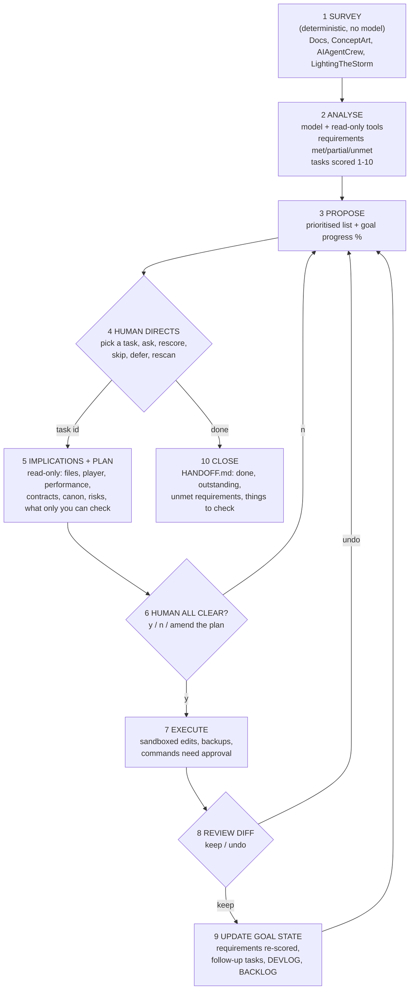

# Goal-Oriented Coding Agent for *Lighting the Storm*

A command-line agent that works towards one goal, keeps track of how far it has got, and only acts when the creator says so.

> **Goal:** bring `LightingTheStorm/` to the state the GDD describes for the Gate 1 vertical slice, consistent with the concept art and the AI crew briefs, **or** document precisely what remains so work can resume later.

It does not decide what to build. It finds the gap between the design and the game, scores it, asks the creator which gap to close, explains what that will affect, and only then changes files.

## Run it

```bash
cd GoalOrientedAgent
pip install -r requirements.txt
python main.py              # first run: survey + analyse, then the interactive loop
python main.py --dry-run    # survey only: shows what it would read, no API calls, no cost
python main.py --rescan     # re-analyse against the current files (closed tasks are kept)
```

It uses `ANTHROPIC_API_KEY` from `GoalOrientedAgent/.env`, or falls back to `../AIAgentCrew/.env` (same key and workspace as the crew). Model: `claude-sonnet-5-5`, override with `GOAL_AGENT_MODEL` or `--model`. State persists in `state/backlog.json`, so you can quit and resume.

## Assignment deliverables: where to find each one

| Deliverable | Where it is |
|---|---|
| **1. Source code:** the agent that reads the GDD, scans the codebase and generates code | This folder. Entry point `main.py`; the pieces are in `goa/`. **Reads the GDD and scans the codebase:** `goa/survey.py` plus the read tools in `goa/tools.py`. **Judges and proposes:** `goa/agent.py` and `goa/prompts.py`. **Generates code:** the execute phase (`Agent.execute`) using `write_file` and `edit_file`, only after you approve. See [Files](#files). |
| **2a. A working feature the agent built** | **T01, the central `GameState` controller** (`LightingTheStorm/scripts/core/game_state.gd`). Documented in [Working feature documentation](#working-feature-documentation-t01-gamestate), with the agent's own handoff note at `LightingTheStorm/HANDOFF_T01_GameState.md`. |
| **2b. What the feature is** | [What the agent built](#what-the-agent-built) |
| **2c. Why the agent chose it** | [Why the agent selected this feature](#why-the-agent-selected-this-feature) |
| **2d. Manual changes before accepting the code** | [Manual changes before the code was accepted](#manual-changes-before-the-code-was-accepted) |
| Supporting evidence | `GOA Findings.md` (all 24 findings, explained simply), `GOA Dependency Order.md` (the build order), `BACKLOG.md`, `DEVLOG.md`, `HANDOFF.md`, and `logs/` (the full transcript of every session, including the failed one). |

## The cycle



| Phase | Who does it | What happens |
|---|---|---|
| Survey | Python | Reads the five core GDD documents in full (Exec Summary, Technical Strategy, AI Agent Strategy, Decisions to be made, What's Changed) plus the review-board synthesis; indexes every other doc; indexes all concept-art folders and attaches one downscaled image from each; reads the crew roster (`roles.py`), story beats and README; maps the game (file tree, line counts, `readme.md`, `things to work on next.md`). About 32k tokens. |
| Analyse | Model | Extracts about 20 testable requirements from the GDD, then reads the scenes, scripts and data to mark each met / partial / unmet with evidence. Turns the gaps into tasks and returns them through a structured tool call, so the output is data, not prose. |
| Propose | Python | Prints tasks sorted by score, with a goal-progress bar (met = 1, partial = 0.5, over all requirements). |
| Direct | You | `T01`, `ask ...`, `score`, `skip`, `defer`, `goal`, `rescan`, `undo`, `done`. |
| Implications | Model (read-only) | For the chosen task: approach, ordered steps, files to change or create, implications for the player, performance, other agents' contracts, canon and docs, reversibility, risks, and what only you can check in Godot. If a creator decision blocks it, it says so and refuses to guess. |
| Execute | Model (write tools) | Only after you type `y`. Edits are minimal and match the surrounding code. |
| Review | You | Diff summary, full diff on request, then keep or undo. |
| Update | Python | Re-scores affected requirements, adds follow-up tasks, appends to `DEVLOG.md`, rewrites `BACKLOG.md`. |
| Close | Python | On `done`, writes `HANDOFF.md` so the work can be picked up later. |

### Priority scoring

| Score | Meaning |
|---|---|
| 10 | Absolute must: the slice cannot be played end to end, or a pillar or hard rule is broken, without it |
| 8-9 | Needed to pass a Gate 1 exit test or to unblock several other tasks |
| 6-7 | Important to quality or to the agent pipeline, but the slice runs without it |
| 4-5 | Polish, robustness, consistency, documentation that will matter soon |
| 2-3 | Nice to have; later gates |
| 1 | Not required at all, nice to do some day |

Every task carries a "why this score" line saying why it is not one point higher or lower, plus the document sections and file paths that are the evidence.

## Safety and control

- **Read-only until you approve.** The analysis and planning phases cannot write anything.
- **Write allow-list.** Only `LightingTheStorm/`, `Docs/` and `AIAgentCrew/`. Concept art is read-only; `.git`, `.godot` and `.env` files are never readable or writable.
- **Backups and undo.** Every file is copied to `state/backups/<task>/` before its first change; new files are recorded so undo deletes them. `undo` works for a task even after restarting the agent.
- **Commands need approval.** `run_command` asks you each time and has a deny list (`git push`, `git reset --hard`, `rm -rf`, and so on).
- **The creator decides canon.** The prompts forbid settling unresolved story or design decisions (the GDD's "Decisions to be made" list); those become tasks marked "needs you", never auto-executed.
- **Honest about verification.** The agent cannot run the Godot editor, so each result lists what it verified and what you still have to check by playing.
- **Everything is logged.** `logs/session_*.md` records the agent's reasoning notes, every tool call (collapsible), every plan and diff, and every line you typed.

## Files

| Path | Purpose |
|---|---|
| `main.py` | CLI, the human-in-the-loop cycle, rendering |
| `goa/survey.py` | Phase 1: gathers the four sources |
| `goa/prompts.py` | System prompts, the scoring rubric, and the structured-answer schemas (`submit_analysis`, `submit_plan`, `submit_result`) |
| `goa/agent.py` | Analyse / plan / execute / ask phases |
| `goa/llm.py` | The model-and-tools loop (streaming, prompt caching of the survey) |
| `goa/tools.py` | Sandboxed tools: `list_dir`, `read_file`, `grep`, `view_image`, `write_file`, `edit_file`, `run_command` |
| `goa/state.py` | Persistent goal state (requirements, tasks, history) and the session log |
| `goa/docs.py` | Writes `BACKLOG.md`, `DEVLOG.md`, `HANDOFF.md` |
| `state/backlog.json` | Source of truth for requirements and tasks |
| `BACKLOG.md` | Human-readable backlog, regenerated on every change |
| `DEVLOG.md` | Append-only record of executed tasks (created on the first execution) |
| `HANDOFF.md` | Written when you say `done` |
| `GOA Findings.md` | The 24 findings from the first analysis, each explained simply with the work, outcome and cost |
| `GOA Dependency Order.md` | The dependency review: missing tasks, build waves, the critical path (see [Dependency order](#dependency-order)) |
| `logs/` | Full transcript of every session |

## Result of the first real run (2026-10-19)

The survey ran, then the analysis made 13 tool calls reading the scenes, scripts and data before reporting. It scored the project at **26%** (1 requirement met, 9 partial, 11 unmet of 21) and concluded the game is "a strong tech spike for the sea and world, but not yet a playable Gate 1 slice". Top of the backlog:

| ID | Score | Task |
|---|---|---|
| T01 | 10 | Central `GameState` autoload: phase machine, event bus, restart |
| T02 | 10 | Greybox lighthouse interior: door, hall, basement, stairs, lantern room (needs you: scene work in the Godot editor) |
| T06 | 10 | Burner pickup at the Saltgate, boat cargo, return-departure clock trigger |
| T07 | 10 | Hidden ship deadline, ship placeholder, elapsed-time lighting, debug time scale |
| T08 | 10 | Win and fail outcomes, "Failed" screen with reason, restart (needs you) |
| T03-T05 | 9 | Interaction system and boiler job; window, rowboat and island gate; lantern-room diagnosis |
| T09, T10 | 8 | Decide the fail reason line (a creator decision); integrate the crew's hazard forecast |
| ... | ... | 24 tasks in all, down to T24 (score 2): the walkway's jagged rock wall and darkness |

Three findings it made that are not in `things to work on next.md`: nothing in the level calls `DialogueLoader.trigger()` and the loader is not in `Level.tscn`; `Level.tscn` overrides the boat speed to 10.0 while `boat_spec.json` says 3.0; and the crew's `return_crossing.json` and `crossing_loader.gd` are not used by the game at all.

Then task T01 was selected. The agent made 15 read-only tool calls and produced a plan (new `scripts/core/game_state.gd`, phase enum from the Technical Strategy, event bus that forwards to `DialogueLoader`, events limited to IDs already in `AIAgentCrew/canon.py`), flagged that the GDD does not say which event starts the BOARDING phase and declined to invent one, and waited. The first answer (in an earlier test) was `n` and nothing changed; the second time the creator answered `y` and the task was executed. What happened next is in the feature documentation below. See `BACKLOG.md`, `HANDOFF.md` and `logs/` for the actual output.

## Dependency order

**Score is not build order.** The agent ranks tasks by how much each matters to the Gate 1 slice. That is the right way to *choose what matters*, but it is the wrong way to decide *what to build next*, because several high-scoring tasks quietly need things that are not on the backlog, and some low-scoring tasks block high-scoring ones. `GOA Dependency Order.md` is the review that fixes this. Read it alongside `GOA Findings.md`; where the two disagree about ordering, the dependency document wins.

What it contains:

- **Missing tasks found.** The creator spotted that nothing on the backlog made the burner, let the player carry it, or put it on the boat. The review traced every dependency and added **T27-T33** (burner design decision, greybox props, carry system, NPCs and path follower, ship and route, burner fit split out of T08, boiler job split out of T03).
- **Hidden ordering problems.** For example the boat docking check (T25, score 5) must come before the burner pickup and the deadline (T06 and T07, score 10), and accepting the four proposed event IDs (T26) must come before anything that emits them.
- **A dependency graph** (mermaid) with an arrow for every "must exist first".
- **Six build waves.** Wave 0 decisions and bookkeeping, Wave 1 foundations the agent can build without the editor, Wave 2 spaces, props and actors, Wave 3 the story beats in order, Wave 4 the stakes and the ending, Wave 5 quality and polish. Tasks inside a wave are independent.
- **The critical path:** **T16 → T02 → T28 → T05 … T06 → T07 → T32 → T08**. T02, the lighthouse interior, sits on almost every path and is the largest schedule risk.
- **A note on why the agent missed it.** Tasks came from requirement gaps, not from a "what objects does each beat need" check; "blocked by" was free text; and the list was sorted by score alone. This is a design limit of the agent and is recorded as a finding.

What changed in the agent as a result:

- **Seven tasks added:**
  - T27: decide what the burner is
  - T28: greybox props
  - T29: carrying and boat cargo
  - T30: NPCs and a path follower
  - T31: the ship and its route
  - T32: the burner fit, split out of T08
  - T33: the boiler job, split out of T03
- **T01 closed.**
- **Every task now has a `depends_on` list and a build wave.** `BACKLOG.md` gains a "Build order" table, and the CLI marks a task `[waiting on T..]` while any of its dependencies is open.
- **Backup:** the previous state is in `state/backlog.before_dependency_pass.json`.
- **Caution:** `rescan` replaces all open tasks, so it would drop this pass. The analysis schema does not yet ask the model for `depends_on`.

## Working feature documentation: T01 GameState

### What the agent built

**T01, "Create the central GameState autoload: phase machine, event bus, restart"**, the agent's first executed task. It is the game's conductor: one always-loaded script that knows which part of the story the player is in, and the single place every other system reports to.

| Piece | File | What it does |
|---|---|---|
| `GameState` autoload (new, generated) | `LightingTheStorm/scripts/core/game_state.gd` (about 290 lines) | The nine story phases from the Technical Strategy (ARRIVAL_AND_COAL to RESOLUTION); `emit_event(id)`, the one place anything reports "this happened"; the 32 stable event IDs from `AIAgentCrew/canon.py` plus four proposed ones; one-shot events per attempt; a debug event log; forward-only phase changes; an outcome that resolves once; `restart()`. It listens to the boat's signals and turns them into events (`BOAT_CAST_OFF`, `SALTGATE_REACHED`, `RETURN_DEPARTED`), tells the `Dialogue` autoload so Ted and Arthur speak, and drives the lighting rig's phase. Debug keys: F9 restart, F10 print the log, F11 stand-in for the burner pickup. |
| Registered as an autoload | `LightingTheStorm/project.godot` | `Dialogue` and `GameState` are listed under `[autoload]`. |
| Hooks into existing code | `scripts/world/boat.gd`, `scripts/world/lighting_rig.gd` | The boat joins a `"boat"` group so GameState can find it; the rig stops listening to the boat itself (`follow_boat_signals = false`) and takes its phase from GameState. |
| Fixes to existing code | `scripts/dialogue/dialogue_loader.gd` | A generation counter so a line that is mid-wait when the slice restarts is dropped, not spoken in the new attempt. |
| Headless test | `LightingTheStorm/tools/test_game_state.gd` | Checks the autoloads exist, the phase table, one-shot rules, forward-only phases, the outcome-once rule and the restart fix. Passes (`RESULT: OK (0 failed)`) on Godot 4.3. |
| Handoff note | `LightingTheStorm/HANDOFF_T01_GameState.md` | The agent's own record in the GDD's handoff format: files changed, how to run, observed behaviour, what to check, the four proposed IDs. |

What it means for the player so far: when the level starts Ted greets the player, casting off and docking at the Saltgate are logged as story events, and the lighting follows the story. Nothing new is visible on screen. It is plumbing, which is why other tasks hang off it.

### Why the agent selected this feature

1. **It scored 10/10, tied for the top.** The agent's reasoning, from `BACKLOG.md`: *"Nothing else can be wired without it, and the slice cannot run end to end, so it is a 10. It is not scored lower because six other tasks depend on it."*
2. **It serves three unmet or partial requirements at once:** R15 (an explicit phase state machine with stable event IDs), R14 (restart after a fail) and R10 (the hidden deadline needs a place to live).
3. **It fixed a gap the analysis found.** `DialogueLoader` was not in `Level.tscn` and nothing in the level called `trigger()`, so none of the opening dialogue could play.
4. **It needed no editor work.** It is code only, so the agent could do it on its own; the interior (T02) and the endings (T08) need the Godot editor and creator decisions.
5. **The creator chose it.** The agent only proposes; the creator typed `T01` and then `y` at the all-clear.

The later dependency review confirmed the choice: T01 sits at the root of the graph, with the burner thread, the deadline and the outcomes all downstream of it (see [Dependency order](#dependency-order)).

### How it got built (the honest sequence)

1. **First run, 14:27.** The agent generated `game_state.gd` and `test_game_state.gd`, edited `boat.gd`, `lighting_rig.gd` and `project.godot`, and ran the headless test (the first run showed failures; it fixed the test's start-up timing).
2. **It stopped part-way.** The next API call failed with *"Your credit balance is too low to access the Anthropic API"*. The files already written stayed on disk. This is the most important practical cost of running the agent: it needs funded API credit to finish a task.
3. **Offline continuation, 14:36.** The creator told the agent to carry on offline (without the API). A Claude Code session acting in the agent's role (see the log) re-read the work, found it already present, checked it line by line against the Technical Strategy and `canon.py`, ran the tests again, added the restart fix and the F11 key, and wrote the handoff note. Its record is in `DEVLOG.md` and `logs/session_20261019_143455.md`.
4. **Play-test by the creator.** See the next section.

### Manual changes before the code was accepted

The agent's code was not accepted as it came. These are the changes and decisions made by a person or after human testing:

| # | Change | Who and why |
|---|---|---|
| 1 | **Test start-up timing.** `tools/test_game_state.gd` gained `await process_frame` because autoloads had not finished starting when the test began. | Made inside the first run after the headless test failed 5 checks. |
| 2 | **Restart safety and the F11 key.** `dialogue_loader.gd` generation counter, F11 pickup stand-in, one extra test check. | Added in the offline continuation after review found a stale dialogue line could play after F9, and that leaving the Saltgate could never reach the RETURN phase until the burner pickup exists. |
| 3 | **First-start bug fixed in `game_state.gd` `_ready()`.** On a fresh launch the console never printed `[GameState] #1 GAME_STARTED`; the first line was `#2`, after the creator pressed F9. Cause: on first launch Godot adds the main scene to the root before the autoloads' `_ready` runs, so GameState missed the "scene entered" signal. Fix: also look for an already-present scene at start-up and run the same step once, deferred. | Found by the creator's own play-test of the agent's check list; fix written by Claude Code (about 7 lines). The agent could not have found this, because it cannot run the game window. **Re-test pending: confirm a fresh run now prints `#1`.** |
| 4 | **Creator decisions on the proposed contract.** The four event IDs the agent proposed (`RETURN_ARRIVED`, `BURNER_FITTED`, `SHIP_WIN`, `SHIP_FAIL`) and its phase boundaries were put to the creator as task T26, which the creator closed with the Wave 0 answers (A17-A25 in the GDD's "Decisions to be made"). | Creator. The agent is not allowed to settle contract questions. |
| 5 | **Bookkeeping corrected.** The agent could not update its own backlog (outside its write area), so `state/backlog.json` was updated afterwards: T01 marked done and the stale "project.godot has no [autoload]" evidence on R10 and R15 corrected. | Done in the dependency pass. |

**Checks the creator still has to complete in Godot** (from the agent's own list): F10 prints the event log; F11 then cast off gives `RETURN_DEPARTED` and the RETURN lighting; F9 reloads cleanly and a line playing during F9 does not reappear. The creator's first pass confirmed `GAME_STARTED`, Ted's greeting, `BOAT_CAST_OFF` and `SALTGATE_REACHED` with the phase changes.

**Known issue the agent found but did not cause:** `tools/test_boat.gd` times out at step 10 and still exits 0. It was traced to stale test routing, not to GameState (this is T25, since resolved: the boat was fine, the test route was out of date).

> To document a second feature in the same way, copy the five headings above and fill them in from `DEVLOG.md`, the task's handoff note and the session log.

## How this was made

**The request** (to Claude Code, 2026-10-19):

> I want to build a Goal-Oriented Coding Agent. I want it to read the contents of my Doc folder, especially my GDD (Exec, Tech, and AI Agent strategies), refer to my Concept Art and the briefs of my AI Crew and compare its analysis with the game files in "LightingTheStorm" in the same working directory. It then needs to propose a list of prioritised tasks, with a priority scoring out of 10 (10 is an absolute must, 1 is not required at all but would be nice to do at some point). It must then prompt me for direction on which task to perform, what the implications are, to execute the task if I give the all clear, and to keep repeating this until I say the requirements are met, or suitably documented for further work later. This Goal-Oriented Coding Agent needs its own working directory with a README.md file so I can share this entire conversation and process with my tutor who will be grading this work. It can go in the root of AI_GameDev for now.

**Design decisions and why**

1. **A Python program that calls the Anthropic API directly, not a CrewAI crew.** The creator's crews run a fixed pipeline once and exit. This agent has to loop, wait for a human between steps, and choose its own investigation path, so it needs a tool-use loop. The Anthropic SDK and the existing API key were already in the project.
2. **Goal state, not just a to-do list.** The agent extracts requirements from the GDD and tracks each as met / partial / unmet, with a progress percentage. Tasks exist to move requirements. After executing a task the requirements it touched are re-scored. This is what makes it goal-oriented: it can say how far from the goal it is and what changed.
3. **Survey in code, analysis by model.** Gathering files is deterministic, cheap and repeatable, so it is plain Python. The model is spent on judgement: comparing and scoring. The big survey is cached so each tool turn re-reads it cheaply.
4. **Structured outputs through tool calls.** Analysis, plan and result come back as validated JSON (`submit_*` tools), so the UI, the backlog and the handoff are built from data rather than parsed prose.
5. **Separate "implications" step before "all clear".** The brief asks for implications before execution, so planning is its own read-only model run, and execution is a different run that receives the approved plan (and any amendment you typed).
6. **Tasks the agent cannot do alone are labelled, not hidden.** Editor scene work, playtests, paid API calls and creator decisions are shown with "needs you". Choosing one produces the implications and records the blocker rather than guessing.
7. **Bug found and fixed during testing.** The first live run showed the model dropping the `LightingTheStorm/` prefix in tool paths (the survey tree is relative to that folder), so every read failed. Fixed by labelling the tree and the prompt, and by a path fallback in `tools.py`.

**Known limits**

- It cannot run Godot's editor, so nothing it writes is play-tested; results say so.
- Analysis quality depends on the model reading the right files; each claim carries evidence so you can check it. Scores are judgement against a rubric, which is why you can `score` a task yourself.
- Only one image per concept-art folder is attached up front; it can `view_image` others on demand.
- `AdminHelpers/AGENTS.md` asks agents to log to `Docs/DevLog.md` at a stale path; this agent keeps its own `DEVLOG.md` instead.
