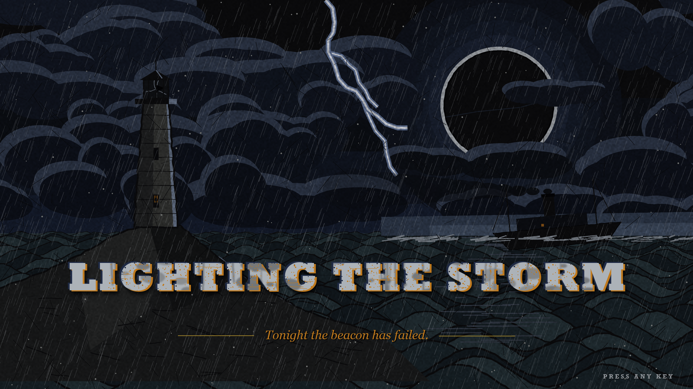
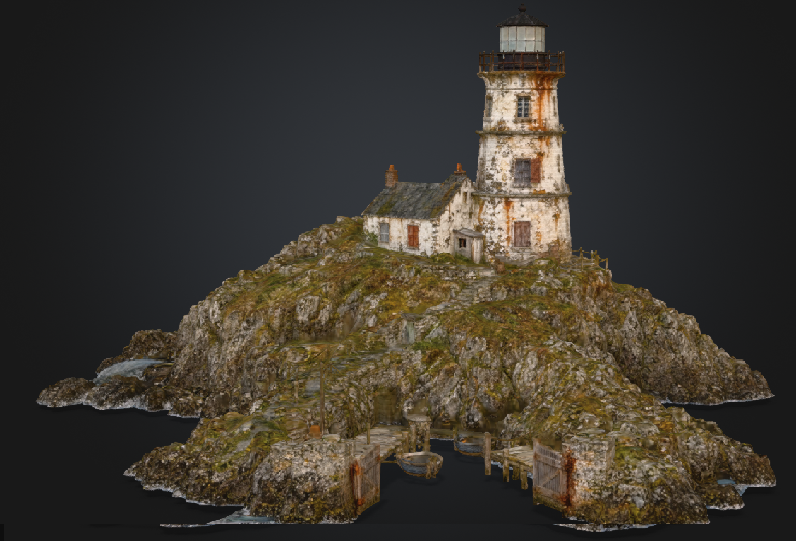

# AI_GameDev

## Generated Artifact #1: Intro Splash Screen

**File:** `LightingTheStorm/INTRO_SPLASH_SCREEN.png` (1920x1080)
**Generator:** `LightingTheStorm/tools/build_intro_splash.py` (Python + Pillow, re-run it to regenerate the image)

### What was provided

Claude read the GDD and the Lore Build (`Docs/Lore Build/world/WORLD.md`, `style_guide.md`, `pillars.md`, `systems/sys_eclipse.md`, `factions/fac_flighted.md`) and produced a title screen for *Lighting the Storm* straight from the lore:

- **Setting:** the Bracken Isle lighthouse in a mid-1800s gaslight-and-steam storm. It is unlit, its lens is cracked ("Tonight the beacon has failed"), and a silhouetted figure stands in a dim window (pillar 1, the haunted lighthouse).
- **The eclipse:** a near-perfect black sphere sits over a silver moon with a thin silver rim all round. There is only a faint tilted seam and a barely-there keel point to hint it may be a ship (pillar 2, the mystery of the moon).
- **The storm:** layered cel-shaded storm clouds, a lightning strike, driving rain, a rough sea and a steam liner pitching toward the isle with one dim amber lamp.
- **Style and palette:** built from the style guide's palette (ink black, navy, sea slate, stone grey, silver, amber), with wobbly hand-traced ink outlines, hard-edged cel shadows and grimy paint texture.
- **Title treatment:** "LIGHTING THE STORM" in a weathered, misregistered slab-serif letterpress style, with the tagline "Tonight the beacon has failed." and a small "PRESS ANY KEY" at bottom right.

### How it was made: chat history

**1. First request**

> based on the GDD and Lore build folders, generate an intro screen with the game title in a suitable vibe, and save it to the "LightingTheStorm" root folder as INTRO_SPLASH_SCREEN.png

Claude drew a first version: lighthouse, eclipse and a stormy sea.

**2. Reset to the lore**

> reset that image according to the lore - this is a world set in the mid 1800s and is gritty with supernatural / alien overtones. Make the darkshape covering the moon more like a space ship of sorts (only show minor hints that it may be a space ship) and don't forget to show the storm

Claude added a steam-liner ship, heavy storm clouds, lightning, rain and grit, and gave the dark shape some ship-like details.

**3. Challenge: put it through the agent crew**

> run this image through the appropriate member of the agent crew and list their suggestions

The crew in `Agent Crew/roles.py` has no art director, so Claude used the **Asset agent** (palette, style and reference-sheet fit), with the Lighting agent and Canon and Review Orchestrator checks added. The review ran as a subagent playing that role; the real CrewAI pipeline was not run, because it is built for return-crossing data, not image review. Its suggestions:

1. Eclipse sphere is too explicit as a ship (mast, keel spike, portholes, rivets). Keep one faint seam or keel point.
2. The eclipse sits beside the moon, not over it. Centre it on a full silver disc with a thin rim all round.
3. Stray amber glows read as a second light source. Remove them.
4. The sky behind the eclipse is too bright and moonlit. Darken it toward navy and ink.
5. The beacon reads as lit, which undercuts "the beacon has failed".
6. No strong story light. Add hard-edged cel shadow and a cold lightning rim light.
7. Rendering is clean vector, not heavy ink outlines, hand-traced linework or grimy hand-painted texture.
8. The ship is tiny with toy-like yellow lights. Make it a clearer steam silhouette with smoke and one dim amber lamp.
9. The foreground pebbles look like cartoon ovals.
10. Title fill is too clean and bright. Grime it toward silver.
11. Tagline and "PRESS ANY KEY" are low contrast.
12. Pillar 1 (haunted lighthouse) is not hinted. Add a silhouetted shape at a dark window.

**4. Decisions**

> Agreed with 1. Agreed with 2. Agreed with 3. Agreed with 4 (make it stormy clouds) Agreed with 5, turn off the light of the lighthouse and crack the lens. Agreed with 6. Agreed with 7. Agreed with 8. Remove the pebbles. Agreed with 10. Move the "press any key" to bottom right of the screen and make it smaller. Agreed with 12.

Claude applied every accepted change and produced the final image above.

## Generated Artifact #2: Character Dialogue Sequences

Dialogue for Ted, Jeff and Daniel across the first three steps of *Lighting the Storm* (load coal into the boiler, let the stranded sailors in, retrieve the burner), written by a CrewAI "Opening Dialogue Crew" and revised after its own reviewer sent it back. The pathway from prompt to result is the diagram at the end of this section.

**Start here:** [Character Dialogue Sequences index](Docs/Lore%20Build/dialogue/README.md)

### Opening dialogue pages

- [**Final opening dialogue**](Docs/Lore%20Build/dialogue/DIALOGUE_OPENING_FINAL.md): all characters, by step and game event, after the revision round (56 lines, reviewer verdict PASS)
- [Iteration 1: live model, reviewer verdict REVISE](Docs/Lore%20Build/dialogue/DIALOGUE_OPENING_LIVE.md): the first live draft, before the reviewer's issues were fed back
- [Offline draft: the scripted first version](Docs/Lore%20Build/dialogue/DIALOGUE_OPENING.md): the 61-line draft the offline run replays
- [Opening dialogue flow illustration](Docs/Lore%20Build/dialogue/illustration_opening_dialogue_flow.png): the three steps, Ted's key line for each, and the event chain

### Character pages

| Character | Lines | Page |
|---|---|---|
| Ted, the lighthouse master | 23 | [DIALOGUE_TED.md](Docs/Lore%20Build/dialogue/characters/DIALOGUE_TED.md) |
| Jeff, the sailor who guides the crossing | 25 | [DIALOGUE_JEFF.md](Docs/Lore%20Build/dialogue/characters/DIALOGUE_JEFF.md) |
| Daniel, the young sailor in the basement | 8 | [DIALOGUE_DANIEL.md](Docs/Lore%20Build/dialogue/characters/DIALOGUE_DANIEL.md) |

Each page has the character's voice notes from the lore file, then every line with the game event that plays it, its delivery direction and any staging notes.

**Game data:** `Agent Crew/storm_crew/storm_crew/sample_output_live_revised/dialogue_opening.json` (Godot 4 JSON with stable IDs) and `LightingTheStorm/scripts/dialogue/dialogue_loader.gd` (plays lines when the game reports an event). See [`LightingTheStorm/data/dialogue/README.md`](LightingTheStorm/data/dialogue/README.md). The game project's own `data/dialogue/dialogue_opening.json` is still the earlier offline version (61 lines); the revised one was deliberately kept separate.
**Generator:** `Agent Crew/storm_crew/storm_crew/main_dialogue.py` (the Dialogue task and its checks), `LightingTheStorm/tools/build_character_pages.py` (the pages), `LightingTheStorm/tools/build_pathway.py` (the diagram).

### What was provided

- **Ted introduces the player to the setting and each objective.** In the final version he sets the scene (eclipse, storm season, the Saltgate) and then gives the three tasks: feed the basement boiler, open the gate for the sailors, fetch the replacement burner. He is gruff and snarky and calls the city's rich "new money toffs".
- **Jeff and Daniel** react at the gate, in the hall and on the launch. Jeff guides the crossing; Daniel settles by the boiler and is anxious and funny about it.
- **Dynamic behaviour, not just a script.** Key moments have alternates (17 groups, one plays at random each run), four stall ladders escalate hints when the player is stuck, assist mode adds a plain-text hint, and the player's handwritten journal updates as steps pass.
- **The player is "the new guy"** and never speaks. Nothing mentions a timer, shows a marker or confirms a supernatural cause.

### How it was made: chat history

**1. First request**

> Generate a list of dialogue options for the characters based on the GDD and the contents of the "Lore Build" folder. Make comments from Ted which introduce the player to their setting and what they need to do at each point (step 1, load coal into the basement for the light, step 2 let the stranded sailors in, step 3 retrieve the burner for the beacon)
>
> Refer to the Agent Crew for direction and styles.
>
> Generate a list of files that can be used by a Godot4 game engine and provide a separate illustration for inclusion in a class assignment I need to hand in.

Claude read the GDD, the Lore Build and the Agent Crew's canon and call-sheet style, then wrote 61 lines as Godot JSON, a loader script and a flow illustration. It used the crew as a style guide and did not run it.

**2. Refinements and a first pathway diagram**

> Refer to the player as "the new guy"
>
> Ted's position is fine for now.
>
> Visualise your pathway - from my prompt, through to the lore, and which agents used - in a diagram if possible, demonstrating the agents generate dynamic content.

Every "apprentice" became "the new guy". The first diagram stated plainly that the Agent Crew had not run.

**3. Challenge: make the agent crew do it**

> Create a Dialogue task to storn_crew that reuses the same checks, and rerun the same dialogue generation through them, and THEN visualise the pathway from my prompt through them to the results.

Claude added a three-agent Dialogue task to `storm_crew` (Production Orchestrator, Dialogue agent, Canon and Review Orchestrator), each gated by a guardrail that reuses the crew's checks. An offline run with a scripted model reproduced the earlier dialogue line for line. A negative test with an impossible word limit was blocked and wrote no game data.

**4. Challenge: use the Anthropic API**

> use the anthropic api key

The live run needed a workspace ID, a model the workspace has, and no temperature setting. The first live model invented its own event IDs and broke its JSON, so the brief check was tightened to the game's real events (no content check was loosened). On the next run the guardrails blocked two Dialogue attempts (1 error, then 28) before the third passed. The reviewer then returned **REVISE**: Daniel's lines triggered outside the basement and Jeff's poster lines implied an outpost interior. It also miscounted the lines ("76" for 56).

**5. Challenge: feed the reviewer's issues back**

> feed the reviewer’s issues back to the Dialogue agent, add this iteration to the Diagram..

The reviewer's six issues went back to the Dialogue agent, who changed 10 lines and kept 46 verbatim: the outpost lines were reworded, Ted's staging moved to the hall, and the poster lines became optional step-0 events. The revision passed the same guardrail on its first attempt and the re-review returned PASS (14 of 14 checks). Two checks were added from this round: a line's step must match its event's step, and a reviewer's line counts must match the data.

### Limits to know about

- The re-reviewer is the same model marking its own fix, so this is not independent approval. The creator still approves voice and lore before anything is recorded.
- The loader script has not been run inside Godot.
- In the live version "the new guy" appears in about a third of the lines (19 of 56), which reads mechanical, and Ted's setting introduction is thinner than in the offline draft.
- The offline run and the negative test used a scripted model (no API call); only the live runs used the Anthropic API.

### Pathway: from prompt, through the agent crew, to the game

## Artifact #3: Island and Lighthouse Static Asset

**Folder:** [`LightingTheStorm/Assets/Island/`](LightingTheStorm/Assets/Island/README.md) (the GLB files, `scene.json` and the viewer patch)
**Tools:** `LightingTheStorm/tools/island/` (Blender and Bun scripts that built and tested it)

### What was provided

A game-ready exterior for the Bracken Isle lighthouse, built from a Meshy-generated GLB that was imported into the project:

- **Island and lighthouse:** 150,000 triangles (down from 1,464,180) with 4096px textures (22 MB, down from 101 MB). Boats removed, and the stairs and pier kept at higher detail.
- **Sea:** a flat 640 m grid (256 x 256 cells) ready for waves to be animated later.
- **Collision:** a 30,000-triangle collision mesh, a plank gangway from the pier end to a closed double gate, and invisible barriers so the gate is the only way up.
- **Route to the lighthouse:** behind the gate a corridor leads to a spiral stair shaft inside the mountain, which comes out on the original stone steps below the cottage and the lighthouse.
- **Viewer:** a patch to the Image Blaster viewer so it can show the scene and walk through it with collision.

### How it was made: chat history

**1. First attempt: Image Blaster and World Labs**

> Analyse the image in input using the Image Blaster workflow. Stop after analysis and show me every candidate object before calling World Labs or FAL.Do not make any paid generation requests yet.

Claude found 11 object candidates in the concept image and flagged that most were buildings or fixed pier parts. The decision:

> Keep only these candidate objects for separate generation: wooden-rowboat, pier-gate. [...] Treat all of those as part of the static World Labs environment for this first prototype.

After "Yes, make the one plate edit with nano-banana" and "use this plate", Claude made one FAL edit (clean plate, boat and gate removed) and one World Labs world generation. These were the only paid calls.

**2. Inspect the result**

> Please start the Image Blaster viewer and inspect the generated Stormbound Lighthouse Island world before making any more paid API calls.

Claude had no browser access, so it judged from the World Labs thumbnail and panorama and a check of the collider: the island was small and blurry, and the dock had been replaced by an invented one. Verdict: keep but rebuild.

**3. Rebuild from a Meshy model**

> it needs to be completely rebuilt as the dock is completely different and the island is blurry. please try rebuilding with the PNGs I've now saved in C:\GameDev\Meshy

The folder held four turntable screenshots (front, back, left, right) of a Meshy-generated GLB. Claude pointed out that the Image Blaster pipeline only takes one image, and offered three routes. The choice:

> I have option 1

That meant using the GLB itself, `FBX_Meshy_AI_Detailed_Lighthouse_I_0927195657_image-to-3d-texture.glb`: one fused mesh of 1,464,180 triangles with no collider.

**4. Make it game-ready in Blender**

> Blender is installed - and aim for a 150k triangle count

Claude decimated it headlessly in Blender 5.2 and rendered the result next to the original. The stone steps had blurred into the rock, so the steps and pier were protected during decimation, which fixed them. Textures were shrunk from 8192 to 4096 pixels (65.6 MB to 22.5 MB). The Image Blaster viewer was extended to load the island as the environment in place of the splat.

> do 2 first, then 1, then regenerate the viewer so I can see what you're doing

**5. Boats, collision and sea**

> Boats feel wrong and there is no collision mesh on the island which means I can't walk up to the lighthosue to test it, also remove the boats in the pier for now. There will be an added rowboat later if we can get this working. Can you generate a "sea" surface that I can then animate with waves later?

The boats were cut out of both the visual and collision meshes, and a sea grid was generated.

**6. Testing the collision**

> http://localhost:5173/stormbound-lighthouse-island shows no collision, are you able to view? tell me how to do that.
>
> spawn point is fine, but I'm still falling through the island at that same spawn point

Claude drove a headless Chrome from a script to see what the viewer did. The physics world held only one collider, the safety net: the island's collision mesh was never created, because the physics engine skips hidden meshes. Putting it on a camera layer that never renders fixed it. The player then stood on the dock (y of about 0.79) and stayed there. Walking forward also showed that the pier deck ends about 7 m from the spawn, 5 m short of a dark opening in the rock. The original model has the same gap.

**7. The gate**

> it looks like there is a "door" in the path up to to the lighthouse from the dock [...] I'm happy for that to be the "lockable" gate in the story. so reinforce that

Claude located the opening at the pier end and asked how to proceed. The choice was "Gangway + solid gate": a plank gangway across the gap, a closed double gate with a stone frame, and the door area kept at full detail. A physics test walked a player-sized capsule across the gangway and the gate stopped it.

**8. A way through the mountain**

> make the door you've created the one and only way into the lighthouse, so cut a pathway through the mountain so it then merges with the "steps" you see just before the lighthouse. collision is working better, let's leave at at the for now.

The mountain rises about 12 m between the gate and the steps, and a straight stair at a walkable angle needs about 20 m of run, so Claude built a corridor and a spiral stair shaft inside the mountain, with a short stair out to the original steps. Getting the capsule through took several rounds, each found by ray-casts at the point where it stalled:

- the corridor and landing walls blocked each other
- the spiral's first treads rose too early, so a flat entry sector was added
- the shaft was too tight and steep, so it was made wider with shallower steps
- a step 0.37 m high stood beside the last tread, more than the player's 0.46 m jump allows
- a trench cut left a hole in the hillside past the last step

The result: with the gate open, the capsule walks the whole way from the spawn to the lighthouse base (96 of 96 waypoints in 15 s). With the gate solid it stops at the gate. A search then found 46 places where the pier area meets climbable rock, and invisible barriers were placed there. With them, the summit is unreachable from the pier for any step up to 0.5 m.

### How it was tested

- **Physics simulation:** a capsule the size of the player, in the same physics engine the viewer uses (Rapier), run from the spawn to the lighthouse with the gate open and solid.
- **Reachability search:** a grid search over the walkable surface, with and without the tunnel and barriers.
- **Headless viewer:** the viewer loaded in headless Chrome, with the console checked for errors and the physics colliders counted (6, as expected). Typecheck passes.
- **Renders:** Blender close-ups of the dock, gangway, gate, corridor and shaft.

### Limits to know about

- The gangway, gate and tunnel are untextured placeholders, and the tunnel interior is unlit.
- The route was verified in a simulation and the viewer was loaded and inspected headlessly. It has not been walked by hand in the live viewer.
- The gate is set to walk-through (`"solid": false`) in `scene.json` so the route can be tested. Set it to `true` to lock it. There is no key or lock logic yet.
- The door placed is the opening at the pier end, which may not be the one boxed in `the_gate.png`. A few tiny splinters remain where the boats were.
- The Meshy mesh is one fused piece, so the lighthouse, cottage and pier cannot be moved separately.
- The original 101 MB GLB and the earlier iteration files are not in the repo. The viewer patch is against `neilsonnn/image-blaster` and is not committed in that repo.
